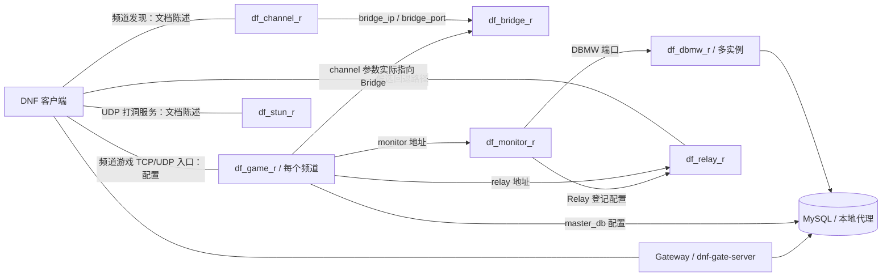

# 多人地下城架构：部署平面与尚未确定的模拟平面

**研究状态：静态 v0.1**。进程/端口是配置事实；进程内部副本实例与游戏循环仍未知。

## 可识别的服务

| 服务/程序 | 已检查材料支持的职责 | 已知端口或配置 | 证据级别 |
|---|---|---|---|
| `df_game_r` | 文档称处理“地下城等级和地下城内游戏进行”、角色、装备等；每频道有独立启动命令 | `tcp_port=__SERVER_GROUP__00__CHANNEL_NO__`、`udp_port=__SERVER_GROUP__10__CHANNEL_NO__`；示例频道 11 为 30011/TCP + 31011/UDP | 已证实（文档/配置） [E01][E04][E05][E09] |
| `df_stun_r` | 文档将其定位为 UDP 打洞辅助服务 | `2__SERVER_GROUP__11/12/13`；示例 2311-2313/UDP | 已证实（文档/配置） [E02][E06][E09] |
| `df_relay_r` | 文档称不能直连时中继客户端通信；连接 Monitor 配置信息 | 当前示例 7300/TCP+UDP；历史文档 7200 | 已证实（文档/配置），转发内容未知 [E02][E07][E09] |
| `df_channel_r` | 频道信息下发（文档描述），向 Bridge 取信息 | 示例 7001/TCP+UDP | 已证实（文档/配置） [E01][E08][E09] |
| `df_bridge_r` | 收集/维护频道信息，配置 `d_channel_...` 数据库 | `__BRIDGE_TCP_PORT__`；历史文档 7000 | 已证实（文档/配置） [E01][E08] |
| `df_monitor_r` | 文档称跨服务器组防重复登录、聊天/邮件通知等；Monitor 显式配置 DBMW、Manager、Relay | `__MONITOR_TCP_PORT__`；历史文档 30303 | 已证实（文档/配置） [E03][E07][E21] |
| `df_dbmw_r`（多实例） | DB 中间件：`dbmw_mnt`/`dbmw_guild`/`dbmw_stat` | 监控实例连接 `d_taiwan` 与本地 MySQL 代理 | 已证实（文档/配置），调用细节未知 [E21] |
| `df_gate-server` | 登录/认证配套网关，读取数据库和 `GAME_SERVER_IP` | 示例 5505/TCP（HTTP） | 已证实（脚本/Compose） [E09] |

注：表内的“职责”若来自 `doc/ArchitectureDiagram.md`，证实的是**该文档作出了此陈述**。尚不是独立动态验证。具体端口随 `SERVER_GROUP`、频道、脚本环境而变化。

## 已知部署与连接配置图

以下实线表示仓库**显式配置或文档描述的关系**，**不是抓包验证后的实际应用消息流**。

**注意：** `game/cfg/server.template:23-25` 的 `udp_ip_of_channel`、`tcp_port_of_channel` 取的是 `__MAIN_BRIDGE_IP__` 与 `__BRIDGE_TCP_PORT__`。所以其变量名 `channel` 不应直接解读为与 `df_channel_r:7001` 对接。参见 [E04](evidence.md#e04) 和 [E08](evidence.md#e08)。

## 生命周期与多进程边界

`start_game.sh` 以 `channel_no` 和 `process_sequence` 生成频道配置，启动 `./df_game_r "$channel_name" nofork`；`s6` 的 `game_template` 声明依赖 Bridge、数据库初始化、数据库代理、Monitor IP 解析、安全代理等。**部署上是频道级进程隔离**，并没有证据表明“每队一进程”或“每队一线程”。[E05][E22]

`frida.js` 将 `G_GameWorld()` 和 `CParty::...`、`CDungeon::...`、`MapInfo::...` 作为当前游戏进程中可调用的对象/函数，这使“游戏进程参与副本状态管理”成为有力的研究方向。然而脚本只证明自己**引用了这些函数地址和接口**，并没有给出每个副本的 Actor、线程、tick 或内存结构布局。[E10][E12][E14][E16][E17]

## 需要区分的三层状态

| 层 | 可见线索 | 最关键未知 |
|---|---|---|
| 会话与频道层 | `G_GameWorld`、`CUser`、`CParty`；频道进程/端口 | 哪些状态跨频道迁移，掉线时缓存多久 |
| 副本战斗层 | `CDungeon_get_index`、`CParty::OnFightVillageMonster`、`MapInfo::Add_Mob` | 普通副本实例标识、怪物 AI/HP 所有者、P2P Host 职责 |
| 经济/持久化层 | `CInventory`、`CUser_gain_exp_sp`、`ReqDBSend...Mail`、MySQL/DBMW | 普通掉落、结算与数据库事务、幂等操作标识 |

**小结：** 现在可以画出可启动的频道服务拓扑，但不可以给出确定的“每队副本运行时”框架。验证路径见 [副本生命周期](dungeon-lifecycle.md)。
