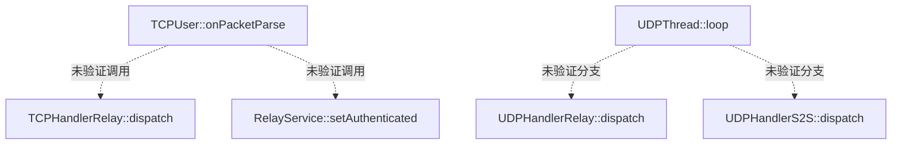

# 二进制静态研究：Relay 与 STUN（v0.2）

分析基线：`1d59eeafeaa105a3c109091c3d5fc061a30bbf19`。本轮通过 GitHub 连接器读取两个 ELF 的 Base64 原始内容，在内存中解析 ELF 头、节区头、符号表与字符串。**不是反编译或动态抓包，也未执行目标程序。**

| 对象 | 文件大小 | ELF 格式 | Git blob SHA |
|---|---:|---|---|
| `neople/relay/df_relay_r` | 418,098 B | 32-bit x86, 入口 `0x8049B80`，含 `.symtab` | `c39c47eeb19127a105a0c3309e9b663de81e239a` |
| `neople/stun/df_stun_r` | 131,126 B | 64-bit x86-64, 入口 `0x401440`，含 `.symtab` 和调试节 | `9e8e459f5bc1144617213d3141e2c5a740e2bc2c` |

## Relay：从真实 ELF 符号表解析到的函数

| C++ 函数名（简化显示） | 虚拟地址 | 符号大小 |
|---|---|---:|
| `RelayServiceApp::TCPUser::onPacketParse` | `0x0805D02E` | 1334 B |
| `RelayServiceApp::TCPHandlerRelay::dispatch` | `0x0805B958` | 312 B |
| `RelayServiceApp::UDPHandlerRelay::dispatch` | `0x0805E4C0` | 56 B |
| `RelayServiceApp::UDPHandlerS2S::dispatch` | `0x0805E406` | 144 B |
| `RelayServiceApp::RelayService::relayToTCP` | `0x08051B76` | 70 B |
| `RelayServiceApp::RelayService::setAuthenticated` | `0x08051B2C` | 74 B |
| `RelayServiceApp::PacketHeaderS2S` 构造函数 | `0x0804EA92` | 62 B |
| `RelayServiceApp::Packet_Relay_User_Check` 构造函数 | `0x0804EAD0` | 52 B |
| `RelayServiceApp::TCPAcceptThread::loop` | `0x0805B2DA` | 934 B |
| `RelayServiceApp::TCPThread::loop` | `0x0805BB8E` | 559 B |
| `RelayServiceApp::UDPThread::loop` | `0x0805E642` | 745 B |

原始 Itanium ABI 符号示例：`_ZN15RelayServiceApp7TCPUser13onPacketParseEv`、`_ZN15RelayServiceApp15UDPHandlerRelay8dispatchEPcii`、`_ZN15RelayServiceApp13UDPHandlerS2S8dispatchEPcii`。

二进制中还存在字符串 `Relay Server v2.5.6.9`、`Monitor Auth: Fail.. Disconnect User!!`、`Auth Packet Queue: %d`、`Error UDPS2SSocket!! Not Auth mode`、`Set Relay Server for PVP Channel`。

**能够证实的结论：** Relay 二进制具有**包解析、鉴权以及 TCP/UDP/S2S 分类处理的代码入口**，不能把它不加限定地称作“完全透明、毫不解析任何报文的字节转发器”。**仍未知：** 这些入口是否全部在当前运行配置触发；它们的调用关系；`S2S` 的业务含义；是否理解位置、技能或伤害消息字段。

## STUN：线程相关真实符号

`stunProcess1(void*)`：`0x4017A4`；`stunProcess2(void*)`：`0x401722`；`stunProcess3(void*)`：`0x401674`。

实际字符串：`Create Thread1 RealIP Socket`、`Create Thread2 NAT Socket`、`Create Thread3 MTU_CHECKER Socket`、`RealIP Port: %d, NAT Port: %d`、`STUN Server v1.4.0.0`。三个线程入口与名称都存在，但**尚未通过反汇编核对每个入口对应哪个端口或如何收发数据**。

## 下一步需检验的边（**以下全部是假设**）

## Game ELF 尚未解析

`build/dnf_data/home/template/init/df_game_r` 大小 36,360,954 字节、Git blob `f7a65ba7bc723e96fadeae07e87b72e05560d989`。当前 GitHub 连接器未返回此大文件正文，故**本轮没有验证任何 `frida.js` 中的 Game 函数地址，也不能得出副本状态存储或战斗权威结论**。`doc/台服dnf服务架构.docx` 正文同样未取得。

随研究目录提供一份 [Game ELF 只读检查脚本](tools/inspect-game-elf.sh)，用于实体检出环境的 `file` / `readelf` / `objdump` / `strings` 分析。该脚本没有在本次对 Game ELF 运行。
