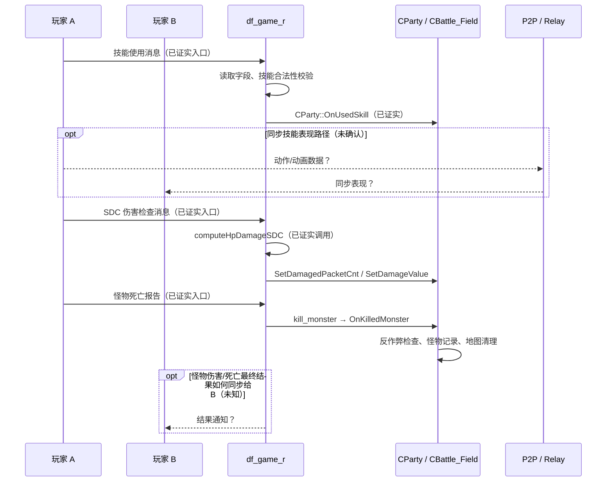

# v0.6：普通地下城技能事件、SDC 伤害检查与怪物死亡路径

> **研究范围：** 只读分析本仓库 `df_game_r` 的实际 ELF32 符号与机器码；没有运行 DNF 客户端和服务端、没有抓包。
> **文件基线：** Git blob `f7a65ba7bc723e96fadeae07e87b72e05560d989`；SHA-256 `8859c99d8290dc5fb58151444138cf2697b2bfff12d47d6159596a03f20b5261`。
> **可复核 GitHub Actions：** [第一次伤害/Host 静态探针](https://github.com/hustuhao/dnf/actions/runs/38506571907)、[第二次请求/伤害校验探针](https://github.com/hustuhao/dnf/actions/runs/38506766447)。
> **安全边界：** 静态直接 call 只说明对应代码路径的存在，不能单凭函数名判定线上消息号、怪物 HP 权威或 P2P 传输的实际时序。

## 重要结论

- **已证实（代码级，H）：** `DisPatcher_UseSkill::read` 读取四个字段（byte、byte、short、short）；`process` 会调用技能合法性检查，并调用 `CParty::use_skill` → `CParty::OnUsedSkill`。该服务端链路**没有直接证明所有动画或每次命中都由服务器计算**。
- **已证实（H）：** `Dispatcher_SDC_Damage_Check::dispatch_sig` 从 `PacketBuf` 读取 byte、int 和 binary 数据，在 `0x081EA085` 直接调用 `computeHpDamageSDC`，在 `0x081EA11E` 和 `0x081EA143` 分别调用 `CBattle_Field::SetDamagedPacketCnt` 与 `SetDamageValue`。`ActiveStatus` 版本存在相似字段处理及状态伤害持续时间函数。
- **已证实（H）：** 两个 `Set...` 函数先取得当前 `MapInfo` 的 `std::map<int,map_monster>`，按传入的怪物索引 `find`，目标存在才处理字段。这说明服务端的战场对象确实有按怪物管理的伤害检查/计数字段。**字段具体是否是怪物当前 HP 尚未确定。**
- **已证实（H）：** `DisPatcher_DieMob::dispatch_sig` 显式多次读取 `PacketBuf::get_short/int/byte`，检查用户状态/队伍信息，调用 `CParty::setMonsterMoveHack`、`CParty::kill_monster` 和 `Secu_HackLogCheck::DieMob`；之后 `CParty::OnKilledMonster` 调 `CTraceMobDieHack::addMonsterDamage`、`CHackAnalyzer::addServerHackCnt`、`CBattle_Field::onClearMap`（特定条件）。并非不处理状态就直接发奖。
- **已证实（H）：** `CParty::CheckHackAverageHitCount` 在 `dungeon_clear`、`giveup_game`、`party_dungeon_fail` 等事件中被直接调用；`ClearMapHitCount` 在地下城开始与结束处理被调用。
- **已证实（H）：** `Dispatcher_ChangeHost::dispatch_sig` 可调用 `CParty::change_manager`。`CParty::send_host_info` 通过 `send_to_party` 下发 Host 信息。Host 与网络角色协调存在于服务端，但**Host 负责实时模拟哪些内容仍未确认**。
- **重要排除：** `Dispatcher_ChangeHp::dispatch_sig(0x0820748A)` 调用的是 `pvp_assault::CAssaultMgr::OnChangeHp`（`0x082EF570`），不能拿它证明**普通地下城**怪物 HP 或客户端战斗 HP 同步。

## 1. 技能请求处理入口

| ELF VA | 符号/机器码事实 |
|---|---|
| `0x081CAC5E` | `DisPatcher_UseSkill::read(PacketBuf&, MSG_BASE&)` |
| `0x081CAC7A`、`0x081CACBF` | 两次 `PacketBuf::get_byte` |
| `0x081CAD04`、`0x081CAD46` | 两次 `PacketBuf::get_short` |
| `0x081CADAA` | `DisPatcher_UseSkill::process` |
| `0x081CADD4` | 调 `check_error` |
| `0x081CAE7E` | 构造 `SKILL_USING_VALIDATE_INFO` |
| `0x081CAE89` | 调 `CHackLog_InvalidUsingSkill::IsValidUsingSkill` |
| `0x081CAF15` | 调 `CParty::use_skill(CUser*,int,int)` |
| `0x085A77F9` | 调 `CParty::OnUsedSkill` |
| `0x085B5FFC` | `OnUsedSkill` 内调用 `CParty::isCheckUseSkill` |

**解读：** 可确认服务端处理技能相关请求及校验/统计。四个入包字段的**真实业务类型和线上 opcode 尚需证明**；尤其 `OnUsedSkill` 名字中的 Used 不等于动画广播或命中判定。

## 2. SDC 伤害检查

| ELF VA | 已核验指令调用 |
|---|---|
| `0x081E9E84` | `Dispatcher_SDC_Damage_Check::dispatch_sig` |
| `0x081E9EA7` | `PacketBuf::get_byte` |
| `0x081E9F4A` | `PacketBuf::get_int` |
| `0x081E9FC9` | `PacketBuf::get_binary` |
| `0x081EA085` | `computeHpDamageSDC`，符号地址 `0x08095C32` |
| `0x081EA0D8` | `CHackAnalyzer::addServerHackCnt` |
| `0x081EA11E` | `CBattle_Field::SetDamagedPacketCnt(0x08308F4E)` |
| `0x081EA143` | `CBattle_Field::SetDamageValue(0x08308FF8)` |
| `0x081EA16E` | `Dispatcher_SDC_ActiveStatus_Damage_Check::dispatch_sig` |
| `0x081EA442` | `SDCActiveStatusSyncCommon::getActiveStatusDamageDurationForSDC` |
| `0x081EA5AC`、`0x081EA5CE` | ActiveStatus 版本也调用两个 `Set...` |

在两个 `Set...` 函数的真实指令中（分别在 `0x08308F6C/0x08308F85` 与 `0x08309016/0x0830902F`），可以看到获取当前地图对象和 `std::map<int,map_monster>::find` 查找。**它们不是纯日志输出，确实定位到了服务器持有的当前地图怪物记录。**

但是，`computeHpDamageSDC` 的具体计算内容、调用参数与返回值用途尚未完成函数级反汇编；`SDC` 的协议含义也未由客户端源码或完整调用图确认。**只能说“服务器侧伤害检查计算”，不能替换为“服务器必定计算最终伤害”。**

## 3. 普通怪物死亡消息与结果处理

`DisPatcher_DieMob::dispatch_sig(0x081EB0C4)` 在入口可见：

- `0x081EB0E9`、`0x081EB131`：两次短整型读取；
- 后续多个 `get_int`、`get_byte`、`get_short` 调用；
- `0x081EB635` 检查 `CUser::GetPartyIndex`；`0x081EB686` 调 `CParty::setMonsterMoveHack`；
- `0x081EBB73` 调 `CParty::kill_monster`；
- `0x081EBC1D` 调 `CUser::Send`；
- `0x081EBC6D` 调 `Secu_HackLogCheck::DieMob`。

进一步在 `CParty::kill_monster` 中：
- `0x085A2B44` 调 `CBattle_Field::kill_monster`（具体怪物删除/掉落等）
- `0x085A2D11` 调 `CParty::OnKilledMonster`；
- `CParty::OnKilledMonster` 的 `0x085B5AC4` 调 `CTraceMobDieHack::addMonsterDamage`；
- `0x085B5B0E` 等位置调 `CHackAnalyzer::addServerHackCnt`；
- `0x085B5F7D` 调 `CBattle_Field::onClearMap`。

**解读：** 服务器收到死亡事件后继续执行怪物对象处理、异常检查和地图清理相关逻辑。不能断言服务器之前每帧都维护怪物 HP；静态入口中存在 `MSG_MONSTER_DIE` 参数也不足以单独证明客户端拥有最终死亡判定权限。

## 4. Host/P2P 与本次限定结论

- `CParty::set_host 0x0859CDBC` 中将 `+0x74` 写到 `+0x70`，保存 Host 类字段。
- `CParty::send_host_info 0x0859CDD2` 会经 `CParty::send_to_party 0x0859D14E` 和 `CUser::Send` 给队员下发 Host 关联数据。
- `Dispatcher_ChangeHost::dispatch_sig 0x08204C1E` 在 `0x08204D5C` 直接调用 `CParty::change_manager(CUser*,int)`。这个方法名是“change_manager”，**不能直接等同于底层 P2P Host 迁移/战斗模拟权威迁移**。
- `CParty::ConnectP2P 0x0859A48C` 已见的**唯一直接调用者**来自 `pvp_assault::CAssaultMgr::OnConnectP2PAfterAssault`，不足以认定普通 PvE 必然用这一路径。
- `DisPatcher_ReqPeer` 与 `ResPeer` 存在复杂的队伍/peer 协调逻辑；真实 P2P 承载的**业务消息和方向仍待客户端/流量验证**。

## 5. 当前最有证据支持的模型（不是完整已证实消息时序）

注意：图中 `A→Game` 的消息箭头是按照接收分发入口示意“客户端请求经 Game 分发器处理”，**未抓包确认物理 TCP/UDP、客户端原始命令 ID、A 是否每次都发送此类型的包**；虚线全部是未验证候选。

## 6. 后续 P0

1. **反编译 `computeHpDamageSDC(0x08095C32)`：** 分析其真实参数、数学计算、返回值使用与 `SetDamageValue` 的具体写入偏移，判断它是安全核对值还是权威 HP 扣减。
2. **核验 `SDC_Damage_Check` 的全包字段：** 依次追踪 `get_byte/get_int/get_binary` 写入的栈对象，特别是 binary 的最大长度、目标怪物索引和校验字段，注意不要直接公布未经验证的线上 ID。
3. **定位死亡报告前的权威方：** 对客户端动作/命中回调及 Peer 数据进行两客户端离线抓包。受控测试下对不同 NAT/Relay 条件观察战斗是否继续、哪条通道有伤害结果事件。
4. **Host 语义验证：** 追踪 `send_host_info` 的数据包构造、`change_manager` 与网络 Peer 连接建立路径，确认 Host 是否承担怪物 AI 或模拟时钟，不要将队长和 Host 预设为相同角色。
5. **纯静态后续工作：** 反编译 `DisPatcher_DieMob` 与 `CParty::kill_monster` 的字段校验、重复死亡抑制/怪物唯一键管理；尚未验证双人并发伤害的状态一致性。

所有完整反汇编、字符串和符号中间产物留在 gitignored `artifacts-local`。发布前人工审查脱敏，禁止上传原始游戏账户信息、敏感封包或密钥。
