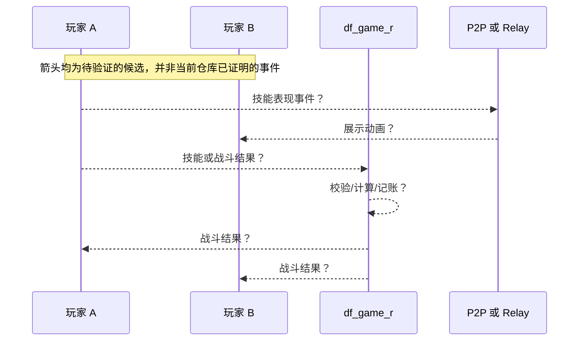
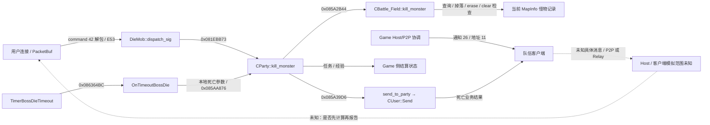

# 技能、伤害与怪物状态同步

> 2026-10-22 更新：已补齐 v0.6 对象所有权任务；保留既有 v0.7。新结论以 [E47–E56](evidence.md#e47) 和 [对象布局补充](game-owner-static.md#instance-ownership-v06) 为准，以下旧版本段落保留研究历史。

## 先区分两类信息

- **技能表现同步**：输入、起手、特效、动画、朝向等。位置与视觉效果的传播并不自动证明伤害结算归属。
- **战斗结果同步**：命中、HP/MP/CD、死亡、奖励归属。即使视觉数据 P2P，结果仍可能由其他一方裁定；反之亦然。

**当前判定：普通地下城技能输入路径、命中判定、伤害计算权威和怪物 AI 运行位置全部未知。**

## 本仓库确实给出的战斗相关代码线索

1. `frida.js:305-308` 声明 `CUser_GetParty(0x0865514C)`、`CParty_get_user(0x08145764)`；脚本遍历最多四个槽来给怪物攻城活动队伍成员加 PT。[E12][E13]
2. `frida.js:1388-1427` Hook 了名称注释为 `CParty::OnFightVillageMonster(0x085B9596)`、`village_attacked::CVillageMonster::OnFightVillageMonster(0x086B3240)`，并替换注释称 `MapInfo::Add_Mob(0x08151612)` 的函数；脚本可在这**个特定事件路径**改变刷怪属性。[E14]
3. `frida.js:1159-1212` Hook 注释为怪物攻城挑战结束 / `SendVillageMonsterFightResult(0x086B330A)` 的流程，并依据传入 `result` 更新 PT。[E13]
4. `frida.js:1537-1567` 在怪物攻城事件完成处理 Hook 中调用 `CUser_gain_exp_sp(0x866A3FE)` 给队友增加额外经验。[E15]
5. `frida.js:171-180` 声明 `CUser_Send`、`GameWorld_send_all`、`CUser_SendUpdateItemList`。注释提及 `CParty::send_to_party` / `GameWorld::send_to_area`（**此两者仅见注释，尚无具体函数地址**）。[E11]

这些事实证实游戏进程中**存在特定怪物攻城逻辑的可 Hook 处理路径**，不能外推为“普通地下城怪物 AI 由 Game 模拟”、或“客户端不能计算伤害”。也不能仅因代码对怪物参数写内存就确定战斗期间持续位置/血量的权威方。

## 需判定的状态所有权矩阵

| 状态 | 当前结论 | 重点实验 |
|---|---|---|
| 技能起手/动画 | 未知 | A 施放技能，分别测量到 Game / Relay / B 的数据与表现 |
| CD / MP | 未知 | 测试客户端本地非法输入是否被拒绝，避免对公网施压 |
| 命中与伤害 | 未知 | 比较 A/B/Game 三端伤害事件产生时间；二进制交叉引用 |
| 怪物位置/AI/仇恨 | 未知 | A/B 各自停止/掉线、抓怪物运动时的网络数据 |
| 怪物 HP 与死亡 | 未知 | 两人同步攻击同一怪物；记录总伤害、死亡事件是否重复 |
| Host 选举/迁移 | 未知 | 捕获队长/Host 离开后的网络拓扑与怪物继续移动情况 |

## 候选战斗事件时序（**仅验证模板**）

**目标验证对象**：相同怪物由不同客户端同时攻击时，确认产生唯一有效死亡、拾取权与奖励的具体机制。当前并无消息类型、频率、二进制数据结构证据，故这里不命名任何虚构技能包或伤害包。

## 第二阶段建议的交叉引用

以 `CParty::OnFightVillageMonster`、`MapInfo::Add_Mob`、`CUser_gain_exp_sp`、`CUser_Send`、`PacketBuf_get_*` 为种子：先 `readelf -h -l -S -Ws`、`file`、`sha256sum` 核查 ELF 版本和映像基址，再在 Ghidra 中证实函数边界/调用者，最后在授权本地小流量场景记录栈、线程 ID 和进程 ID。硬编码地址是 **Frida 作者的声明**，不是本研究独立还原的反编译事实。

## v0.5：Game ELF 中已确认的怪物死亡、拾取与服务器职责边界

这部分不再仅限 Frida 怪物攻城活动代码：以下在真实 `df_game_r` 的 `nm/objdump` 中确认（[完整地址和机器码](game-owner-static.md)、[E37](evidence.md#e37)）。

- 普通 `DisPatcher_DieMob::dispatch_sig` 的 **`0x081EBB73: call 0x085A27E8`** → `CParty::kill_monster(CUser*, int, unsigned short, MSG_MONSTER_DIE const&, int*)`，而 `CParty::kill_monster` 的 **`0x085A2B44: call 0x0830BC78`** → `CBattle_Field::kill_monster`（H）。这证明服务器**接收并处理怪物死亡相关业务**，不是服务器必然模拟每帧 HP 的证明。
- `DisPatcher_GetItem::process` **`0x081C3905: call 0x085A3B98`** → `CParty::get_item`，其 **`0x085A3D19: call 0x0830D9C0`** → `CBattle_Field::get_field_item`；**`0x085A3DC7: call 0x086485BA`** → `CUser::Send`（H）。
- `CParty::dungeon_clear` **`0x085AB74C: call 0x085B3520`** `SaveCoin`、**`0x085AB7E0: call 0x085AAB84`** `_putItemIntoUser`、**`0x085ABB06: call 0x085BF7FC`** `OnSuccessedDungeonClear`（H）。普通结算至少有 Game 侧发放/持久化前处理路径；事务提交和防重逻辑仍未知。
- `CParty::set_host 0x0859CDBC` 的 **`0x0859CDC8: mov [eax+0x70],edx`**，以及 `CParty::ConnectP2P 0x0859A48C`：Host/P2P 协调线索已确证存在（H）。不能推断首领等于主机、主机处理怪物 AI、Game 只转发或 Game 全权计算（均 U）。

**目前最重要的权威分界：** Game 确实实现“怪物死亡事件及奖惩结果的处理”，但是怪物死亡的**产生来源**（客户端报告/Host 结果/服务器计算）及相关校验、伤害计算/逐帧同步未定位（U）。下轮优先反编译 `DisPatcher_DieMob` 读包字段与 `CBattle_Field::kill_monster` 条件分支，再结合 Host/P2P 事件分发证据。

## v0.6：真正的普通战斗请求与伤害检查（2026-10-14）

不再局限于特殊怪物攻城 Hook。已通过完整 Game ELF 直接反汇编确认：

- **技能入站校验**：`DisPatcher_UseSkill::read(0x081CAC5E)` 解包 byte、byte、short、short；`process(0x081CADAA)` 在 `0x081CAE89` 调用 `CHackLog_InvalidUsingSkill::IsValidUsingSkill`，`0x081CAF15` 调用 `CParty::use_skill`，后者 `0x085A77F9` 调用 `CParty::OnUsedSkill`。[E40](evidence.md#e40)
- **SDC 伤害检查**：`Dispatcher_SDC_Damage_Check(0x081E9E84)` 读取 byte/int/binary，`0x081EA085` 调 `computeHpDamageSDC`，`0x081EA11E`、`0x081EA143` 更新战场按怪物查询的受伤包计数与伤害字段。主动状态伤害还有另一条相似处理器。[E41](evidence.md#e41)
- **死亡与反作弊**：`DisPatcher_DieMob(0x081EB0C4)` 解析死亡报文，并经 `CParty::kill_monster`、`OnKilledMonster`、`CTraceMobDieHack::addMonsterDamage` / `CHackAnalyzer` 处理，关卡开始/结束还维护命中计数。[E42](evidence.md#e42)
- **避免误读**：`Dispatcher_ChangeHp` 属于 `pvp_assault::CAssaultMgr::OnChangeHp` 的调用路径，不能当作普通地下城伤害权威的证据。Host 变更处理器调用 `CParty::change_manager`，也不能据此断言 Host 模拟怪物 AI。[E43](evidence.md#e43)

**阶段判断：** Game 进程参与技能合法性和伤害相关数据检查，管理怪物死亡/奖励相关状态；**普通战斗每次命中、最终 HP 扣减、动画同步是否依赖 P2P、Host 具体职责仍未知**。完整调用表/图见 [combat-authority-v0.6.md](combat-authority-v0.6.md)。

## v0.7：SDC 重算与怪物累计统计字段

经完整 ELF 反汇编，[本轮工作流](https://github.com/hustuhao/dnf/actions/runs/38507418346) 进一步证实：`Dispatcher_SDC_Damage_Check` 的 `0x081EA085` 调 `computeHpDamageSDC`，`0x081EA090–0x081EA0A1` 比较计算值与报告值的差距是否在 **±1** 内，超出走 `CHackAnalyzer` 异常计数；之后从用户队伍索引取 `CParty + 0xB24` 战场对象，在当前地图按怪物索引找到 `map_monster`，对 `+0x20` 做 **+1**、`+0x24` 做 **+= 报告伤害值**。[E44](evidence.md#e44) [E45](evidence.md#e45) [E46](evidence.md#e46)

**不能把 `SetDamageValue` 当成 HP 扣血：它是累加器。** 是否真正拒绝异常数据、最终怪物 HP 扣减发生在何处、P2P/Host 是否传播实时命中消息仍未证实。见 [damage-check-v0.7.md](damage-check-v0.7.md)。

## v0.6 所有权补充：死亡事件来源与 Host 边界（2026-10-22）

本节进一步细化此前“死亡产生来源未知”，并保留 v0.7 的 SDC 结论。
证据 [E53–E56](evidence.md#e53)。

| 问题 | 本轮能确定到的边界 |
|---|---|
| 谁报告普通死亡 | DieMob 处理器从 CUser 对应 PacketBuf 解包，沿 state==5 分支按队伍索引调用 kill_monster；客户端是否先接受 Host 结果未知 |
| 服务端检查什么 | PacketBuf getter 失败路径、用户状态、队伍非空、当前 MapInfo 怪物容器中对应记录是否存在有指令证据；全部位置/伤害/归属/Host 权限条件尚未恢复 |
| 服务端是否存怪物数据 | MapInfo+0x0C 有 map<int,map_monster>；存在累计伤害/包计数（E45），尚未定位普通怪物最终 current HP 扣减 |
| 死亡后修改什么 | 成功路径 _MakeDropItems → 怪物 map::erase → IsClearDungeon；CParty 层有 OnKilledMonster、CheckQuestMonster、gain_exp_sp、send_to_party |
| 是否只收报告 | 否，TimerBossDieTimeout:0x086364BC → OnTimeoutBossDie:0x085AA876 → kill_monster；这是受条件约束的超时处理，不证明逐次 HP 由 Game 计算 |
| 是否重复可结算 | 删除后的普通活跃记录再次查询会失败；特殊模式、复活、并发与数据库奖励幂等性未全证实 |

**Host 记录是 CUser*，不是槽号。** P+0x70 保存 Host，P+0x74 保存 manager。
set_host 把后者复制给前者；send_host_info 再找匹配的成员槽，把槽号写入 (0,26)
通知。它没有在这段逻辑中发送 Host IP；成员地址由独立 (0,11) 消息发给队伍。
leave_user 在离开者为 manager 时调用 change_manager，按槽序选首个有效用户，
写 manager、set_host、send_host_info。可确认“manager 离队后的 Host 重设”，
不能扩大为“所有 Host 单独断线都已验证无缝迁移”。

ConnectP2P 处理成员连接完成标志及最多四字节结果，ResPeer 可创建/加入队伍并通知地址。
尚未查出客户端互传技能/怪物位置/伤害的具体代码或线协议。
Game 有死亡结果广播、技能合法性检查、SDC 重算与反作弊；既不能说它仅透明转发，
也不能说它独占全部实时战斗权威。

实线是机器码可确认的处理/发送关系，虚线是未知；客户端死亡的物理产生点、
Host AI tick、当前 HP、peer 复制消息必须继续检查客户端或做获授权隔离动态验证。
