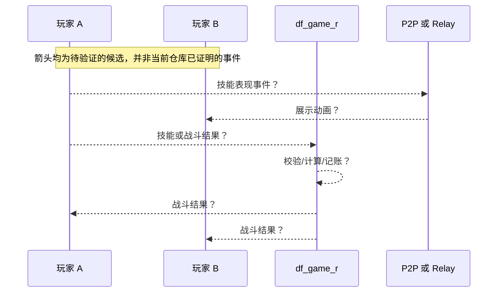

# 技能、伤害与怪物状态同步

## 先区分两类信息

- **技能表现同步**：输入、起手、特效、动画、朝向等。位置与视觉效果的传播并不自动证明伤害结算归属。
- **战斗结果同步**：命中、HP/MP/CD、死亡、奖励归属。即使视觉数据 P2P，结果仍可能由其他一方裁定；反之亦然。

**当前判定：普通地下城技能输入路径、命中判定、伤害计算权威和怪物 AI 运行位置全部未知。**

## 本仓库确实给出的战斗相关代码线索

1. `frida.js:305-308` 声明 `CUser_GetParty(0x0865514C)`、`CParty_get_user(0x08145764)`；脚本遍历最多四个槽来给怪物攻城活动队伍成员加 PT。[E12][E13]
2. `frida.js:1388-1427` Hook 了名称注释为 `CParty::OnFightVillageMonster(0x085B9596)`、`village_attacked::CVillageMonster::OnFightVillageMonster(0x086B3240)`，并替换注释称 `MapInfo::Add_Mob(0x08151612)` 的函数；脚本可在这**个特定事件路径**改变刷怪属性。[E14]
3. `frida.js:1159-1212` Hook 注释为怪物攻城挑战结束 / `SendVillageMonsterFightResult(0x086B330A)` 的流程，并依据传入 `result` 更新 PT。[E13]
4. `frida.js:1537-1567` 在怪物攻城事件完成处理 Hook 中调用 `CUser_gain_exp_sp(0x866A3FE)` 给队友增加额外经验。[E15]
5. `frida.js:171-180` 声明 `CUser_Send`、`GameWorld_send_all`、`CUser_SendUpdateItemList`。注释提及 `CParty::send_to_party` / `GameWorld::send_to_area`（**此两者仅见注释，尚无具体函数地址**）。[E11]

这些事实证实游戏进程中**存在特定怪物攻城逻辑的可 Hook 处理路径**，不能外推为“普通地下城怪物 AI 由 Game 模拟”、或“客户端不能计算伤害”。也不能仅因代码对怪物参数写内存就确定战斗期间持续位置/血量的权威方。

## 需判定的状态所有权矩阵

| 状态 | 当前结论 | 重点实验 |
|---|---|---|
| 技能起手/动画 | 未知 | A 施放技能，分别测量到 Game / Relay / B 的数据与表现 |
| CD / MP | 未知 | 测试客户端本地非法输入是否被拒绝，避免对公网施压 |
| 命中与伤害 | 未知 | 比较 A/B/Game 三端伤害事件产生时间；二进制交叉引用 |
| 怪物位置/AI/仇恨 | 未知 | A/B 各自停止/掉线、抓怪物运动时的网络数据 |
| 怪物 HP 与死亡 | 未知 | 两人同步攻击同一怪物；记录总伤害、死亡事件是否重复 |
| Host 选举/迁移 | 未知 | 捕获队长/Host 离开后的网络拓扑与怪物继续移动情况 |

## 候选战斗事件时序（**仅验证模板**）

**目标验证对象**：相同怪物由不同客户端同时攻击时，确认产生唯一有效死亡、拾取权与奖励的具体机制。当前并无消息类型、频率、二进制数据结构证据，故这里不命名任何虚构技能包或伤害包。

## 第二阶段建议的交叉引用

以 `CParty::OnFightVillageMonster`、`MapInfo::Add_Mob`、`CUser_gain_exp_sp`、`CUser_Send`、`PacketBuf_get_*` 为种子：先 `readelf -h -l -S -Ws`、`file`、`sha256sum` 核查 ELF 版本和映像基址，再在 Ghidra 中证实函数边界/调用者，最后在授权本地小流量场景记录栈、线程 ID 和进程 ID。硬编码地址是 **Frida 作者的声明**，不是本研究独立还原的反编译事实。
