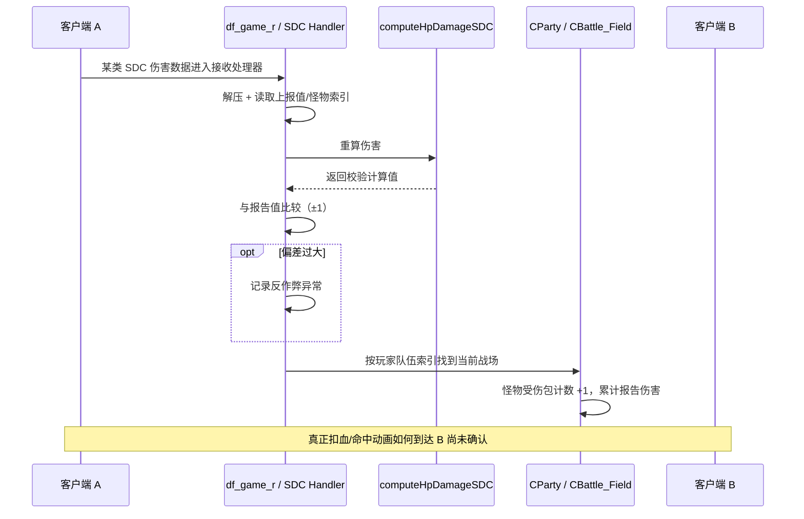

# v0.7：从 Game ELF 反汇编还原 SDC 伤害验证链路

**核心问题：** 普通多人地下城中，“服务端计算伤害”到底是在验证客户端报告值，还是直接扣减怪物血量？

**证据环境：** [GitHub Actions #38507418346](https://github.com/hustuhao/dnf/actions/runs/38507418346)，静态执行 `nm/objdump`，不运行游戏进程、不抓包。Game ELF Git blob `f7a65ba7bc723e96fadeae07e87b72e05560d989`，SHA-256 `8859c99d8290dc5fb58151444138cf2697b2bfff12d47d6159596a03f20b5261`。

## 目前最重要的结论（已证实，仅针对 SDC 检查路径）

服务端对客户端上报的 SDC 伤害相关数据执行**重算、±1 容差比较、异常计数**，随后定位当前队伍的地图怪物对象，对**受伤包计数 +1、累计报告伤害值**进行更新。

**关键排除：** 当前找到的 `CBattle_Field::SetDamageValue` 不是直接修改最终 HP 的函数。它是累加整数的代码。真正的怪物血量扣减和最终死亡判定权威尚未定位，不可以将“服务器重算伤害用于验证”误写成“服务器独立产生所有战斗伤害”。

## 1. 真实计算与校验的调用链

| 机器码 VA | 原生指令或调用 | 可确定事实 |
|---|---|---|
| `0x081EA025` | `call uncompress` | 解压当前输入的伤害数据 |
| `0x081EA066` | `mov eax,[eax+0x1E6]` | 从解压结构读取报告值 |
| `0x081EA085` | `call computeHpDamageSDC(0x08095C32)` | Game 重算一个伤害相关整数 |
| `0x081EA090` | `sub eax,1` | 设置计算值下边界 |
| `0x081EA093–0x081EA096` | `cmp`、`jg` | 如果计算值−1 大于报告值，标记异常 |
| `0x081EA09B–0x081EA0A1` | `add eax,1`、`cmp`、`jge` | 检查报告值是否不超过计算值+1 |
| `0x081EA0D8` | `CHackAnalyzer::addServerHackCnt` | 偏差超过容差走异常记录路径 |
| `0x081EA0E3–0x081EA0F7` | `GetPartyIndex` → `CGameManager::GetParty` | 服务端按玩家的队伍获取队伍对象 |
| `0x081EA11E` | `CBattle_Field::SetDamagedPacketCnt` | 关联战场怪物索引并增加计数 |
| `0x081EA143` | `CBattle_Field::SetDamageValue` | 用上报值更新累计伤害 |

注意：上述 `±1` 是此处理函数的**比较代码路径**，不是所有 DNF 战斗伤害都允许相同误差，也不代表实际安全判定仅存在这一规则。

## 2. 两个 Setter 函数的写入方式（最关键证据）

`CBattle_Field::SetDamagedPacketCnt(0x08308F4E)`：

```text
0x08308FE4  mov eax,[eax+0x20]    ; 怪物记录旧计数
0x08308FE7  lea edx,[eax+1]       ; 自增
0x08308FED  mov [eax+0x20],edx    ; 写回怪物记录
```

`CBattle_Field::SetDamageValue(0x08308FF8)`：

```text
0x0830908E  mov eax,[eax+0x24]    ; 怪物记录旧累计值
0x08309093  add edx,[ebp+0x10]   ; 加上调用时传入的报告值
0x08309099  mov [eax+0x24],edx    ; 写回怪物记录
```

两者都调用 `GetCurrentMapInfo`，再对 `std::map<int,map_monster>` 进行 `find` 查怪物。不存在目标则返回 0。

从处理器 `Dispatcher_SDC_Damage_Check` 的 `0x081EA123–0x081EA143` 入参准备还可验证：作为第三参数传入 `SetDamageValue` 的是上报结构 `+0x1E6` 的值，并非 `computeHpDamageSDC` 返回的校验值。

因此可以用**带证据的伪代码**表示核心部分：

```cpp
// 仅表示已验证的核心内存操作，非原始 C++ 源码
reported = decompressedDamageData.damageValue;    // +0x1E6
computed = computeHpDamageSDC(&decompressedData, ...);
if (reported < computed - 1 || reported > computed + 1) {
    hackAnalyzer.addServerHackCnt(...);            // 阈值和后果未核验
}
party = gameManager.GetParty(user.GetPartyIndex());
if (party != nullptr && monsterExists(party.battleField, monsterKey)) {
    monster.damagePacketCount += 1;                // map_monster +0x20
    monster.reportedDamageTotal += reported;       // map_monster +0x24
}
```

## 3. computeHpDamageSDC 的真实内容

ELF `computeHpDamageSDC(0x08095C32)` 为 `0xAC8` 字节的复杂计算函数，存在浮点运算以及直接调用：

- `0x08095C63` → `getDamageInflict`；
- `0x08095C90` → `isValidAttackInfoElement`；
- `0x08095CCB` → `_SDC::isObjectType`；
- `0x08095E5E` → `SDC_Rand`；
- `0x08095EA3` → `GetUniformVelocityFloatSDC`。

由此证明这不是只简单回显某个输入数值，而包含真实伤害计算逻辑。但当前还不能断言它涵盖普通 PvE 的所有攻击模式、怪物当前 HP 或玩家看到的所有浮动伤害。

## 4. 已支持的消息链路与未知环节



这里 “A→S” 表示游戏服务器具有该**入站分发器**，并非已由 pcap 验证线上 TCP/UDP 传输顺序、频率或消息编号。箭头不能用来证明其它实时表现、伤害事件均走服务器。

## 5. 下一轮最重要的工作

P0：全局交叉引用 `map_monster+0x20/+0x24`，查出统计用途、清零时点、反作弊惩罚条件；另外寻找**实际 HP 字段与扣血写入路径**，并追踪它的消息来源和 Host/P2P 依赖。需要在**获授权的隔离两客户端环境**同步录屏+抓包，补齐当前缺失的“玩家 A 打出命中时，B 究竟从哪里接收一致结果”的最终答案。
