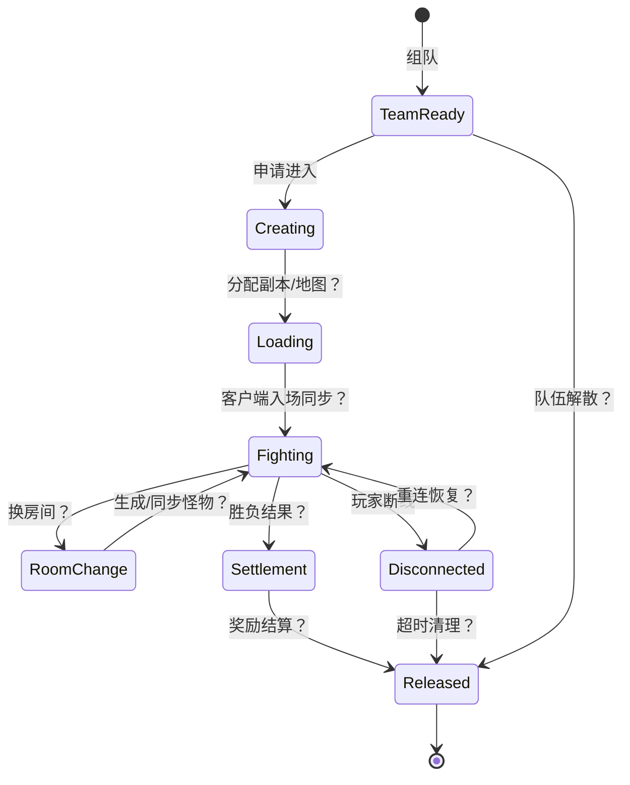

# 地下城实例生命周期（当前为研究状态机）

## 已有的坚实入口

- `doc/ArchitectureDiagram.md:180-203` 把“地下城内游戏进行处理”列在 Game 服务职责中。[E01]
- `start_game.sh:5-29, 33-46` 显示每个频道可启动自己的 `df_game_r` 进程，拥有独立频道配置。[E05]
- `frida.js:1799-1815` 使用 `CParty::UseAncientDungeonItems(0x859EAC2)` Hook，可取得 `party`、`dungeon` 指针并调用 `CDungeon_get_index(0x080FDCF0)`，对特定地下城 ID 实施跳过扣除逻辑。[E16]
- `frida.js:2172-2213` 对 `GameWorld::reach_game_world(0x86C4E50)` 和 `leave_game_world(0x86C5288)` 进行了角色进出世界 Hook。[E18]

**解读限度：** 证据表明游戏进程处理至少部分副本入口/道具规则以及世界进出事件；没有证据定位每队独立实例的数据结构，也没有副本结束释放调用链。

## 候选状态机（所有状态转移均待验证）

图中都是下一阶段应逐一寻找证据的节点和边，**不是声称已还原程序状态机**。

## 进程、队伍、地下城不要混为一谈

频道级 `df_game_r` 进程已由脚本证实；但“频道内含多队”“队伍各自独立地图”“共享主线程 tick”等仍需要结构体和运行时证据。`frida.js:895-953` 确实定义 JavaScript 任务队列，并利用 `TimerDispatcher::dispatch(0x8632A18)` Hook 将自定义任务交给 dispatcher 线程，但**只说明这个 Hook 的队列调度方式**，不能证明游戏副本是单线程模拟。[E17]

## 断线/重连验证方案

1. 在测试服让 A/B 同队入本，记录 PID、频道 ID、队伍对象地址（如可合法 Hook）、副本 ID、双方房间和血量。
2. 强制 A TCP 网络断开，B 保持在场，记录队伍对象/副本对象是否保留与超时；随后让 A 重连，检查是否分配了新的角色对象、队伍对象或副本 ID。
3. 重复队长 A 断线、非队长 B 断线、全队断线三组；区分客户端渲染/缓存和服务端真实状态。
4. 对比 Game 重启与单玩家重连。观察副本是否可恢复，区分内存恢复、持久快照恢复和重新创建。

**所需证据**：对象地址及内存字段需从二进制确认，不能把 `CDungeon_get_index`（地下城配置索引）误作唯一运行实例 ID。

## 仍未知

实例创建、分配及销毁函数，队伍到实例的映射，副本房间切换、掉线超时、Host 变化，玩家重进条件，游戏逻辑线程/事件循环数量。
