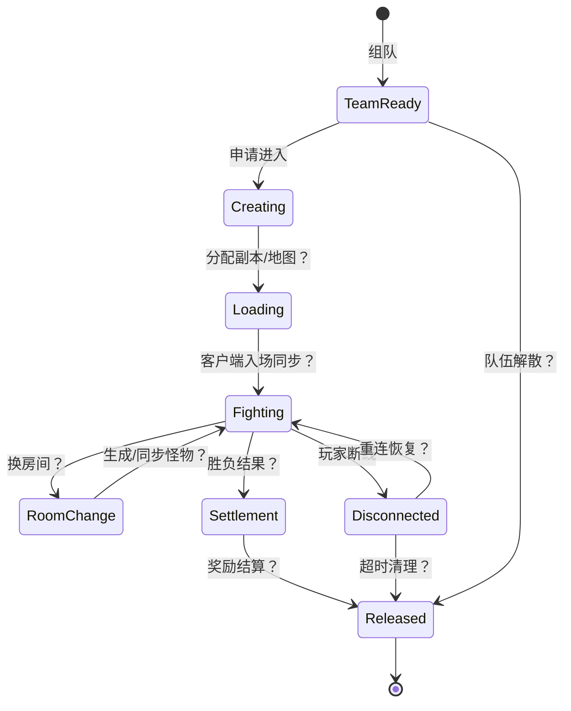
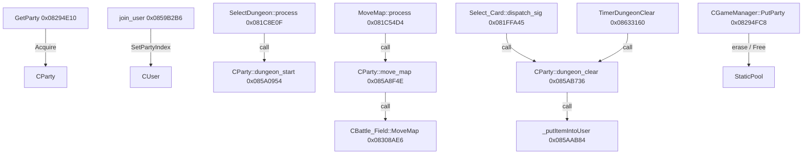

# 地下城实例生命周期（当前为研究状态机）

> 2026-10-22 更新：已补齐 v0.6 对象所有权任务；保留既有 v0.7。新结论以 [E47–E56](evidence.md#e47) 和 [对象布局补充](game-owner-static.md#instance-ownership-v06) 为准，以下旧版本段落保留研究历史。

## 已有的坚实入口

- `doc/ArchitectureDiagram.md:180-203` 把“地下城内游戏进行处理”列在 Game 服务职责中。[E01]
- `start_game.sh:5-29, 33-46` 显示每个频道可启动自己的 `df_game_r` 进程，拥有独立频道配置。[E05]
- `frida.js:1799-1815` 使用 `CParty::UseAncientDungeonItems(0x859EAC2)` Hook，可取得 `party`、`dungeon` 指针并调用 `CDungeon_get_index(0x080FDCF0)`，对特定地下城 ID 实施跳过扣除逻辑。[E16]
- `frida.js:2172-2213` 对 `GameWorld::reach_game_world(0x86C4E50)` 和 `leave_game_world(0x86C5288)` 进行了角色进出世界 Hook。[E18]

**解读限度：** 证据表明游戏进程处理至少部分副本入口/道具规则以及世界进出事件；没有证据定位每队独立实例的数据结构，也没有副本结束释放调用链。

## 候选状态机（所有状态转移均待验证）

图中都是下一阶段应逐一寻找证据的节点和边，**不是声称已还原程序状态机**。

## 进程、队伍、地下城不要混为一谈

频道级 `df_game_r` 进程已由脚本证实；但“频道内含多队”“队伍各自独立地图”“共享主线程 tick”等仍需要结构体和运行时证据。`frida.js:895-953` 确实定义 JavaScript 任务队列，并利用 `TimerDispatcher::dispatch(0x8632A18)` Hook 将自定义任务交给 dispatcher 线程，但**只说明这个 Hook 的队列调度方式**，不能证明游戏副本是单线程模拟。[E17]

## 断线/重连验证方案

1. 在测试服让 A/B 同队入本，记录 PID、频道 ID、队伍对象地址（如可合法 Hook）、副本 ID、双方房间和血量。
2. 强制 A TCP 网络断开，B 保持在场，记录队伍对象/副本对象是否保留与超时；随后让 A 重连，检查是否分配了新的角色对象、队伍对象或副本 ID。
3. 重复队长 A 断线、非队长 B 断线、全队断线三组；区分客户端渲染/缓存和服务端真实状态。
4. 对比 Game 重启与单玩家重连。观察副本是否可恢复，区分内存恢复、持久快照恢复和重新创建。

**所需证据**：对象地址及内存字段需从二进制确认，不能把 `CDungeon_get_index`（地下城配置索引）误作唯一运行实例 ID。

## 仍未知

实例创建、分配及销毁函数，队伍到实例的映射，副本房间切换、掉线超时、Host 变化，玩家重进条件，游戏逻辑线程/事件循环数量。

## v0.5：已确认的生命周期调用边（2026-10-12）

此前章节的「候选状态机」仍不是完整状态机；但现在对**具体入口**已有真正机器码证据，参见 [Game ELF 全文](game-owner-static.md) 和 [E33–E38](evidence.md#e33)。

| 状态相关操作 | 直接反汇编证据 | 置信度 |
|---|---|---|
| 分配队伍 | `CGameManager::GetParty() 0x08294E10` 中 `0x08294E21 call 0x082B0E5A` 分配 CParty | H |
| 绑定成员 | `CParty::join_user 0x0859B2B6` 中 `0x0859B3AF call 0x085BFD96` 设置 CUser 队伍索引 | H |
| 开始副本 | `DisPatcher_SelectDungeon::process` 的 `0x081C8E0F call 0x085A0954` → `CParty::dungeon_start` | H |
| 换图 | `DisPatcher_MoveMap::process` 的 `0x081C54D4 call 0x085A8F4E` → `CParty::move_map`；该方法在 `0x085A9143 call 0x08308AE6` → `CBattle_Field::MoveMap` | H |
| 选卡与通关 | `Dispatcher_Select_Card::dispatch_sig` 的 `0x081FFA45 call 0x085AB736` → `CParty::dungeon_clear`；定时器 `0x08633160` 亦调此函数 | H |
| 道具写回 | `CParty::dungeon_clear` 在 `0x085AB7E0 call 0x085AAB84` → `_putItemIntoUser`，`0x085AB74C call 0x085B3520` → `SaveCoin` | H |
| 回收队伍 | `CGameManager::PutParty 0x08294FC8` 内 `0x0829505A` 调 hash_map::erase、`0x08295072` 调 Pool::Free | H |

因此**可以肯定 `CParty` 接收副本开始/换图/通关处理并与 `CBattle_Field` 协作**，仍不能将其简单等同为副本每帧模拟器。

未知项：以上并未确认 dispatcher 的**上游 opcode 与消息来源**、`dungeon_start` 内资源创建的完整路径、MapInfo 的真实分配/回收、Host 改选、断线重连后的对象留存及结算幂等条件。并且 **`CDungeon::get_index` 返回的类型/配置索引绝不能当作唯一运行实例 ID**。

## v0.6 已确认的对象生命周期与入场通知（2026-10-22）

本节覆盖此前“实例创建/MapInfo 分配均未知”的表述；完整地址表和 Mermaid
见 [所有权补充](game-owner-static.md#instance-ownership-v06)。

1. **构造/分配**：池中的 CParty 构造在 0x082A55B9 对自身 +0xB24
   构造 CBattle_Field；该战场在 0x082A455D 构造 +0x78 地图 map。
2. **初始化/复用**：SetIDX → CParty::init（0x082A59DF）→
   CBattle_Field::reset_field（0x0859ABE2）；后者清配置引用与地图节点。
   入本不是每次分配新的 CBattle_Field。
3. **入本请求**：command 16 注册到 SelectDungeon；
   模板虚调用 read(0x081C7E10)、process(0x081C8102)，
   process 的 0x081C8131 调 check_error，0x081C8E0F 调 dungeon_start。
4. **地图上下文**：dungeon_start:0x085A0DAE →
   CBattle_Field::SelectDungeon:0x082FF486 →
   GetAppropriateMaze / SetGridPath / MapInfo 插入 / ConsistMap。
   B+0x188 保存配置，B+0x1A0 保存难度，默认网格位置在 +0x60/+0x64；
   per-seat/layered 副本有不同选择分支。
5. **成员通知**：普通分支 MakePacket(28/29) 后经
   0x085A1716/0x085A175C 调 send_to_party → CUser::Send。
   0x085A2046 调 send_loadingcheck_msg，其函数体是
   TimerQueue::InsertTimer（0x085B205B），不能按名字说它直接发加载包。
6. **归还池**：CParty::destroy:0x0859AE48 调 init，
   0x0859AE5C 调 PutParty，再经 Pool::Free 把节点放回队列；
   真正 CParty 析构才在 0x082A58ED 析构内嵌战场。

[E47–E52](evidence.md#e47) 支持上述静态调用边；客户端完成加载 ACK、
完整离本分支、Host 单独断线、重连保留与实例唯一世代编号仍未知。
MapInfo 的节点随容器 clear/析构回收，不代表每次 dungeon_start 都必经完整 destroy。
