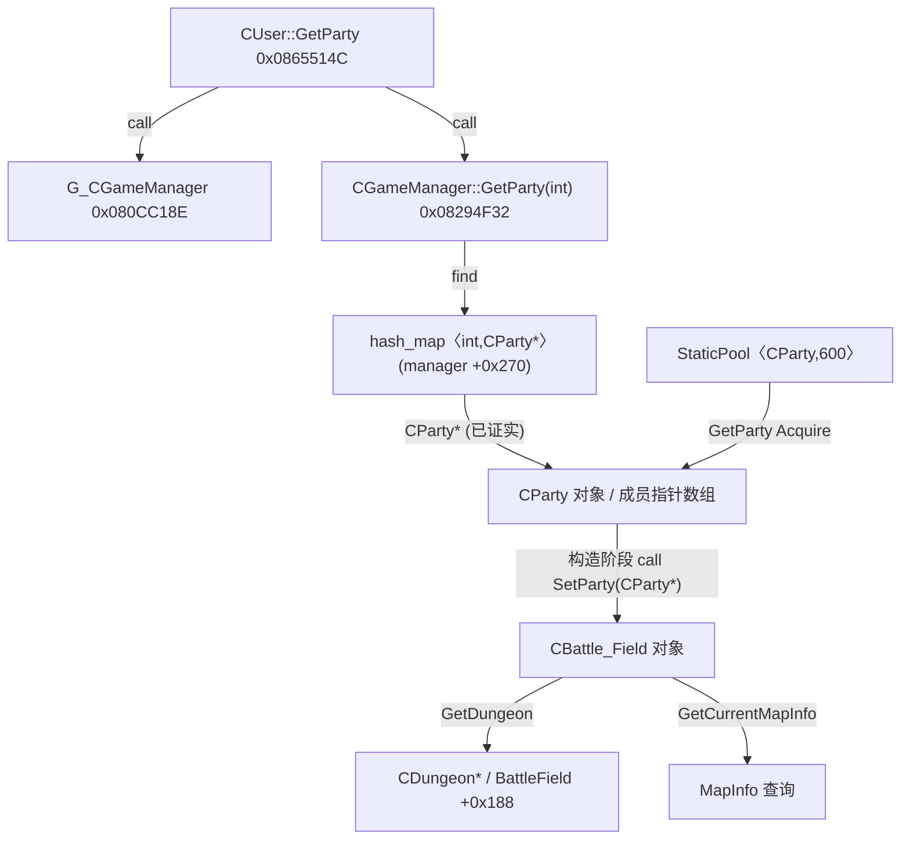
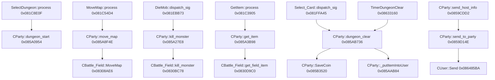

# Game ELF 静态逆向 v0.5：队伍、战场所有权与已发现消息入口

> **证据类型：** 只读 ELF 符号表 + GNU objdump 指令 + 直接调用交叉引用；没有运行游戏程序、抓包或检查客户端。
> 基线 Git blob：`f7a65ba7bc723e96fadeae07e87b72e05560d989`，SHA256：`8859c99d8290dc5fb58151444138cf2697b2bfff12d47d6159596a03f20b5261`。
> 程序：`build/dnf_data/home/template/init/df_game_r`，36,360,954 字节，ELF32 x86 `ET_EXEC`，带 `.symtab` / 调试信息，入口 `0x0807E910`；可执行 PT_LOAD 为 `0x08048000` 起始、`0x01320E61` 字节。
> 可复核工作流：[Game ELF 扫描日志](https://github.com/hustuhao/dnf/actions/runs/38208943902)；[基础扫描日志](https://github.com/hustuhao/dnf/actions/runs/38208637857)。
> 置信度：**H（高）**＝真实函数符号 + 指令确认；**M（中）**＝由多个 H 事实推理出的结构关系，尚未动态验证；**U（未知）**＝不能下结论。

## 一、最重要的答案

**H：** 每频道 `df_game_r` 内的 `CGameManager` 管理 `CParty` 的内存池与以索引查找的对象注册表。玩家 `CUser` 持有队伍索引，通过 `G_CGameManager()` 检索 `CParty*`；队员对象也存储在 `CParty` 内。构造 `CParty` 时，游戏代码给 `CBattle_Field` 设置 `CParty*` 回指针。普通地下城开始、换图、怪物死亡、拾取、掉落和结算代码在 `CParty` / `CBattle_Field` 中存在直接调用。

**M：** 这些关系强烈支持“**频道 Game 进程统一维护队伍及部分副本战场业务状态**”；`CParty` 是组队地下城状态的中心上下文，`CBattle_Field` 是关联的战场/地图数据对象。不能因此认为 **Game Server 对每帧移动、每次伤害、怪物 AI 拥有完整权威**。

**U：** 两名实际客户端的对象地址/PID、`CBattle_Field` 是否直接嵌在 `CParty` 及其准确偏移、每间副本实例 ID、战斗 host 计算范围、断线重连恢复、战斗帧路由和客户端/P2P 权限。

## 二、队伍所有权：真实机器码证据

| 函数或字段 | ELF VA / 指令 | 观察 | 级别 |
|---|---|---|---|
| `CGameManager::GetParty()` | `0x08294E10`; **`0x08294E21 call 0x082B0E5A`** | `StaticPool<CParty,600>::Acquire` | H |
| `CGameManager::GetParty()` | **`0x08294EE2 call 0x082B112A`** | `hash_map<int,CParty*>::operator[]`，队伍注册位置 | H |
| `CGameManager::GetParty(int)` | `0x08294F32`; `0x08294F3B lea ecx,[eax+0x270]`; **`0x08294F52 call 0x082B10C4`** | 从管理器内偏移 `+0x270` 的 `hash_map<int,CParty*>` 调用 `find` | H |
| `CGameManager::GetParty(int)` | **`0x08294F9D mov eax,[eax+0x4]`** | 找到迭代器后取关联的 `CParty*` | H |
| `CGameManager::PutParty(CParty*)` | `0x08294FC8`; **`0x0829505A call 0x082B1190`**；**`0x08295072 call 0x082B11AA`** | `hash_map::erase`，`StaticPool<CParty,600>::Free` | H |
| `CUser::GetParty()` | `0x0865514C`; **`0x08655156 movzx eax,WORD PTR [eax+0x8d004]`** | 玩家对象的队伍索引字段（不等于副本实例 ID） | H |
| `CUser::GetParty()` | **`0x0865516F call 0x080CC18E`**；**`0x0865517B call 0x08294F32`** | `G_CGameManager()` → `CGameManager::GetParty(int)` | H |
| `CParty::join_user(CUser*)` | `0x0859B2B6`; **`0x0859B3AF call 0x085BFD96`** | 调用 `CUser::SetPartyIndex(short)`，关联用户到队伍 | H |
| `CParty::get_user(int)` | `0x08145764`; `0x08145773 shl eax,0x3`; `0x08145779 add eax,0x78`; `0x0814577C mov eax,[eax]` | 按参数索引，从 `CParty + 0x78 + index*24` 取用户指针 | H |

`StaticPool<CParty,600>` 的 `600` 是编译期池模板参数，**不是已测量的最大在线队伍数**。

## 三、战场对象关系

| 函数 | 指令证据 | 解释 | 级别 |
|---|---|---|---|
| `CParty::CParty()` | **`0x082A565A call 0x082A43BE`** | 构造阶段调用 `CBattle_Field::SetParty` | H |
| `CBattle_Field::SetParty(CParty*)` | `0x082A43BE`; **`0x082A43C7 mov DWORD PTR [eax],edx`** | 将 `CParty*` 保存到 `CBattle_Field` 的首字段 | H |
| `CBattle_Field::GetDungeon()` | `0x080FDCFC`; **`0x080FDD02 mov eax,[eax+0x188]`** | 从战场对象 `+0x188` 读取 `CDungeon*`；不证明它是一次运行实例的 ID | H |
| `CBattle_Field::GetCurrentMapInfo()` | `0x0822CBCC`; **`0x0822CBF4 call 0x08300DA6`** → **`0x0822CC15 call 0x0822CC48`** | 获取当前位置，再调用 `GetMapInfoFromPos` | H |
| `CBattle_Field::GetMapInfo()` | `0x0822D03E`; **`0x0822D04A call 0x0822CBCC`** | 返回当前地图信息查询结果 | H |

`CBattle_Field` 的直接持有者/分配方式、`MapInfo` 对象存放位置与多个队伍之间的隔离方式还需检查 `CParty` 和 `CBattle_Field` 构造/析构函数的完整数据流。图中的对象关联不代表 C++ 组合关系已经证实。

## 四、入场、换图、战斗事件、掉落与结算：真实直接调用

以下箭头为反汇编可见的直接 `call`，不等价于网络消息完整链路：

| 业务入口（符号） | 调用点 → 被调函数（ELF VA） | 级别 |
|---|---|---|
| `DisPatcher_SelectDungeon::process` | **`0x081C8E0F call 0x085A0954`** → `CParty::dungeon_start(int,char,ENUM_DUNGEON_TYPE)` | H |
| `DisPatcher_MoveMap::process` | **`0x081C54D4 call 0x085A8F4E`** → `CParty::move_map(MSG_MOVE_MAP&)` | H |
| `CParty::move_map` | **`0x085A9143 call 0x08308AE6`** → `CBattle_Field::MoveMap`；**`0x085A910B call 0x0827A96E`** → `CheckMoveMapFitInPathHackCnt` | H |
| `DisPatcher_DieMob::dispatch_sig` | **`0x081EBB73 call 0x085A27E8`** → `CParty::kill_monster(..., MSG_MONSTER_DIE const&, ...)` | H |
| `CParty::kill_monster` | **`0x085A2B44 call 0x0830BC78`** → `CBattle_Field::kill_monster` | H |
| `DisPatcher_GetItem::process` | **`0x081C3905 call 0x085A3B98`** → `CParty::get_item` | H |
| `CParty::get_item` | **`0x085A3D19 call 0x0830D9C0`** → `CBattle_Field::get_field_item`; **`0x085A3DC7 call 0x086485BA`** → `CUser::Send` | H |
| `DisPatcher_DropItem::process` | **`0x081C30C0 call 0x085A63F4`** → `CParty::drop_item` | H |
| `Dispatcher_Select_Card::dispatch_sig` | **`0x081FFA45 call 0x085AB736`** → `CParty::dungeon_clear` | H |
| `TimerDungeonClear::dispatch_sig` | **`0x08633160 call 0x085AB736`** → `CParty::dungeon_clear` | H |
| `CParty::dungeon_clear` | **`0x085AB74C call 0x085B3520`** → `SaveCoin`; **`0x085AB7E0 call 0x085AAB84`** → `_putItemIntoUser`; **`0x085ABB06 call 0x085BF7FC`** → `OnSuccessedDungeonClear` | H |

观察结果：**服务端确实收到/处理部分副本关键业务事件并维护相关状态**，尤其是换图、怪物死亡事件、拾取、奖励和结算；并未从上述指令证明“服务端计算所有普通怪物伤害或 AI”。`MSG_MONSTER_DIE` 是入参类型，不能把收到死亡报告误写为服务端自行模拟每次攻击。

## 五、发送/队伍 Host/P2P 线索

- `CParty::send_to_party(PacketGuard&)`：`0x0859D14E`，**`0x0859D16A call 0x085B4D12`** `_checkValidUser` 后在 **`0x0859D194 call 0x086485BA`** `CUser::Send(PacketGuard&)`。这是 **Game 端向队员逐个发包** 的已确认机器码路径（H）；不代表所有实时移动都在这一路径。
- `CParty::send_host_info()`：`0x0859CDD2`，**`0x0859CE5C call 0x0859D14E`**。队伍 Host 信息通过服务器的组包/群发路径发送（H）。
- `CParty::set_host()`：`0x0859CDBC`，**`0x0859CDC2 mov edx,[eax+0x74]`**，**`0x0859CDC8 mov [eax+0x70],edx`**。服务器 `CParty` 保存 Host 相关字段（H）；但该字段是否是每帧模拟的权威 Host（U）。
- 符号表包括 `CParty::ConnectP2P(CUser*,char*,int)` `0x0859A48C`、`CParty::send_party_ipinfo()` `0x0859CEA2`，以及 `DisPatcher_ResPeer::dispatch_sig` 对队伍创建/加入的调用。存在 P2P/Peer 连接协调代码（H），仍无法指定移动/伤害/AI 的协议归属（U）。

### 已确认的对象关系（静态机器码）



### 已确认的业务调用边（仅已反汇编直接调用）



## 六、下一步优先验证

1. **P0 静态：** 反汇编 `CParty::CParty`、`CParty::dungeon_start` 与 `CBattle_Field` 的创建/重置：证明 `CBattle_Field` 在队伍对象的确切内存位置，确定谁真正创建、删除 MapInfo 对象；抓 `GetParty/PutParty` 的全部入口。
2. **P0 静态：** 定位 `DisPatcher_SelectDungeon`、`MoveMap`、`DieMob`、`GetItem`、`Select_Card` 的上游消息解码/分发映射，确认消息命令码（从指令取，不从符号名猜）；定位 `PacketBuf_get_*` 对业务结构体填充过程。
3. **P0 静态：** 追查 `CBattle_Field::kill_monster`、服务端怪物状态字段/血量更新和 AI tick 是否存在；比较 `CParty::set_host`、`ConnectP2P`、`send_party_ipinfo` 的条件分支，明确 Host 与 Relay 的作用边界。
4. **P1 动态，另行授权隔离环境：** 同频道双客户端入同本，记录 Game PID、`CParty*`、`CBattle_Field*`、双方队伍索引/房间索引，复核对象共享和断线回收；不同队伍作对照。此次未开展任何动态测试。

## 可复现及限制

```bash
bash research/dungeon-sync/cloud/verify-env.sh
bash research/dungeon-sync/cloud/scan-static.sh
python3 research/dungeon-sync/cloud/probe-game-ownership.py
python3 research/dungeon-sync/cloud/probe-game-paths.py
```

扫描产生的文件保存在 gitignored `research/dungeon-sync/artifacts-local/`。**没有提交原始 ELF、原始 strings dump、网络包、用户数据、私服运行日志或其他敏感内容。** 当前可追溯机器码取自上述 GitHub Actions 日志；后续若更换 ELF SHA，所有地址和偏移均必须重新确认。
