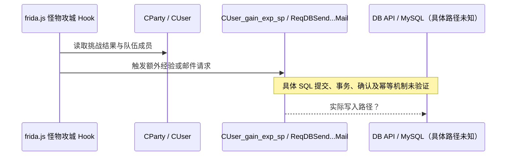

# 掉落、奖励、结算与持久化

**严格区分：普通地下城机制未知；Frida 怪物攻城活动特例有直接脚本证据。**

## 可证实的经济与奖励线索

- `frida.js:88-89` 声明 `CUserCharacInfo_enableSaveCharacStat(0x819A870)` 并在注释中提醒“角色上线时属性从数据库加载到内存，设置脏标记以便下线存档”。**已证实的是脚本的注释与函数声明**，不能推断所有奖励统一在下线才落库。[E10]
- `frida.js:164-170` 声明金币消耗、道具删除、经验发放、时装字段写库请求相关接口。[E11]
- `frida.js:193-197, 380-402, 564-594` 提供 `ReqDBSendNewSystemMail` 与多附件邮件接口；示例中怪物攻城奖励在服务端 Hook 中调用邮件函数。[E19]
- `frida.js:1159-1212` 明确以特定怪物攻城“胜利结果”更新队伍 PT；`:1537-1567` 在另一个该活动完成回调里给队友增加经验，且该附加经验量使用脚本的随机数函数。这是**插件新增活动奖励的随机数来源**，不是普通掉落随机数实现。[E13][E15]
- `frida.js:228-255, 815-825` 还有直接 MySQL 句柄/查询；`game/cfg/server.template:69-74` 为 game 配置主 DB 连接和 3 个 DB 线程；`dbmw_mnt` 同样有独立数据库连接设置。[E20][E21]

## 已证实的某活动奖励链路（仅脚本层）

不能把这张活动特例图画成“普通副本掉落→拾取→结算的已确认完整流程”。

## 普通地下城待回答

| 环节 | 当前证据 | 实验/逆向要求 |
|---|---|---|
| 击杀归属与掉落生成 | 未知 | 查普通怪物死亡触发、物品生成对象 |
| RNG 种子与掉落计算 | 未知 | 跟踪普通副本掉落调用者及随机数来源 |
| 物品在地面上的归属与可见性 | 未知 | A/B 同时观察、错序拾取实验 |
| 双人同时拾取 | 未知 | 在合法本地环境尝试同步拾取，核对唯一库存变更 |
| 通关胜负与奖励计算 | 未知 | 找到副本结束事件与角色经验/金币变化关系 |
| 写库时机 | 配有直连 MySQL、DBMW 与函数请求，但不足以判定具体路径 | 对角色/背包/邮件表记录时间与服务端调用栈交叉核对 |
| 崩溃恢复与幂等 | 未知 | 在本地快照上测试“提交前后”崩溃点，查是否重发奖励 |

## 数据一致性分析模板（尚未证实的目标）

关注 `party_id / dungeon_run_id / kill_id / item_instance_id / settlement_id` 等**期望的关联概念**，但这些只是研究时应寻找的标识，并非已发现的真实字段或数据库表名。若没有唯一结算 ID，必须定位程序实际如何避免重复发奖；不能臆造数据库唯一约束。

可保留的最小审计记录：`实验编号 / 场景触发时间 / 相关玩家 / 观测到的协议事件 / Game PID / 数据库变更前后摘要 / 是否重复`。对数据库写入使用只读观测，任何破坏性崩溃实验仅在可还原备份的隔离环境执行。
