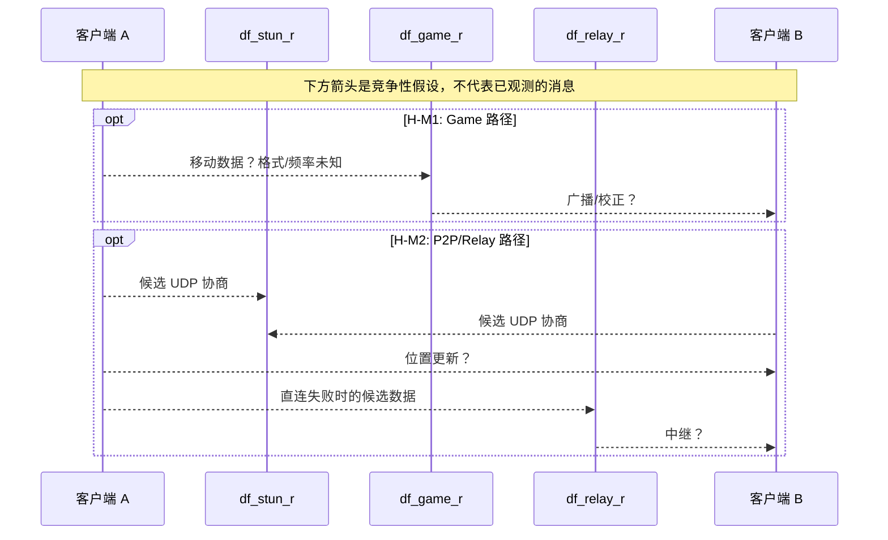

# 多人移动同步：证据与竞争假设

**当前判定：未知。** 目前没有客户端移动消息、移动处理函数、位置校验或抓包证据。Game 配置同时含 TCP/UDP 端口，且 STUN/Relay 参与联机基础设施，这些事实**不能确定移动到底走哪条路径**。[E04][E02][E09]

## 三种待验证路径

- **H-M1：经 Game 转发/处理。** A → Game → B；可能由 Game 验证/广播，也可能仅转发。
- **H-M2：P2P 直连或经 Relay 转发。** A → B，直连失败 A → Relay → B；Game 保留部分会话状态。
- **H-M3：混合模型。** 高频位置表现由 Peer 传递，关键房间/副本状态由 Game 管理。

三者目前都是**待验证假设**，不能按 MMO 常见设计排除某一项。

## 实验最小集合

| 变量 | 操作 | 能确认的结论 | 排除误判的方法 |
|---|---|---|---|
| 移动流量目的地 | A/B 静止 30s → A 连续移动 30s | 哪些链路与移动显著相关 | 重复 20 次、扣除心跳和其他游戏周期包 |
| 移动频率 | 记录动作帧时间与封包到达时间 | 事件式或定期更新的候选规律 | 不将封包数直接等于坐标数 |
| 直连依赖 | 测试网络中禁用 Client↔Client UDP | 能否依然看到 B 的移动表现 | 确认测试拓扑和 NAT 是否真的阻断 |
| Game 依赖 | 在本地可恢复实验中断开 A→Game 连接 | 是否有独立 Peer 移动路径 | 排除客户端暂时保留旧状态/预测画面 |
| 掉包与时延 | netem 注入时延、丢包 | B 是否插值、滞后、瞬移 | 同步录屏与 pcap，未观察不得称有回滚 |

建议采集统一时间轴：`t_input(A)`、`t_send(A)`、`t_recv(Game/Relay/B)`、`t_render(B)`，再映射事件。

## 静态逆向入口（第二阶段）

在匹配版本的 `df_game_r` 二进制中，从已知 `CUser_Send` / `PacketBuf_get_*` 入口反向追踪移动分发调用点；客户端一侧查明实际封包编码函数。在没有交叉引用和动态复现前，不引入任何虚构的 `MovePacket`、消息编号或坐标偏移。

**未确认：** 客户端预测、插值、状态校正、回滚、服务器位置合法性检查、tick 频率、Host 持有位置状态与否。
