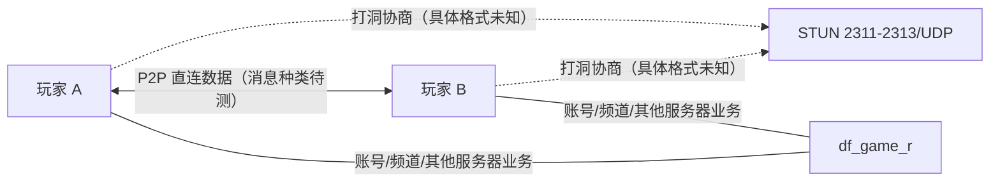
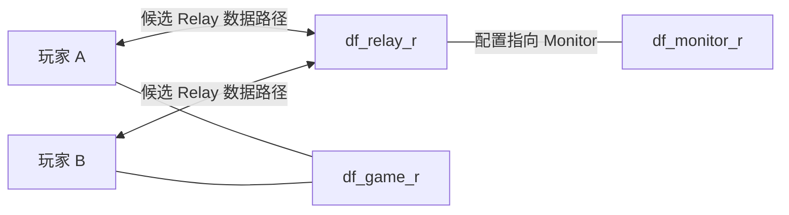

# 网络路径、端口与协议头（静态分析）

> 2026-10-22 更新：已补齐 v0.6 对象所有权任务；保留既有 v0.7。新结论以 [E47–E56](evidence.md#e47) 和 [对象布局补充](game-owner-static.md#instance-ownership-v06) 为准，以下旧版本段落保留研究历史。

## 当前部署示例与历史配置的边界

| 功能 | 现行 `deploy/dnf/docker-compose/basic/docker-compose.yaml` | 其他来源 | 判断 |
|---|---|---|---|
| Channel | 7001/TCP、7001/UDP | `channel/cfg/server.cfg` 由 `__CHANNEL_TCP_PORT__` 替换 | 配置已证实 [E08][E09] |
| Game ch.11 | 30011/TCP、31011/UDP | `game/cfg/server.template` 的频道端口拼接 | 配置已证实 [E04][E09] |
| Game ch.52 | 30052/TCP、31052/UDP | 同上 | 配置已证实 [E09] |
| Relay | 7300/TCP、7300/UDP | `ArchitectureDiagram.md` 写作 7200 | **文档/部署版本差异** [E02][E07][E09] |
| STUN | 2311、2312、2313/UDP | `stun/cfg/udp_server.cfg` 为变量模板 | 配置已证实 [E06][E09] |
| Monitor / Bridge / DBMW | 容器内部端点，没有在该 Compose 示例对外发布 | 历史架构 30303 / 7000 / 20203 等 | 不应推断为公网开放端口 [E01][E03][E21] |

## P2P 成功与 Relay 回退：**候选网络拓扑**

这是基于仓库**文档宣称**的工作方式绘制的候选图，不能推出“移动、攻击、怪物 AI 一定走 P2P”。





仅有“Relay 存在、用于不能直连时中继”的文档证据，**没有**自动回退条件、超时阈值、转发是否解析应用消息的代码证据。`relay_200.cfg` 的 `relay_index=200`、`this_pvp_channel=1` 是配置字段，不足以证明 Relay 只支持 PVP。[E02][E07]

## 游戏应用消息头：字段存在，偏移语义未证实

`game/cfg/server.template:83-90`：

```text
header_classification = 0 1
header_msg_no = 5 1
header_sLength = 1 4
header_checksum = 7 4
header_sequence = 11 2
header_load_interval = 10
header_mangled_length = 13
```

这些是**配置键和值**，可能描述字段位置/长度，但未检查协议解析器之前，不能写成经过验证的封包格式，也不能判定 TCP 与 P2P UDP 是否共用这些字段。[E04]

`frida.js` 明确声明 `PacketBuf_get_byte/short/int/binary` 及 `InterfacePacketBuf_put_header/byte/short/int/binary/finalize`，并在活动广播中调用 `InterfacePacketBuf_put_header(packet_guard, 0, 247/248)`。这证明**Hook 脚本使用编号组包接口**，不等于直接证明底层线上消息 ID/头长度或任何移动技能消息 ID。[E11]

## 通信验证设计（尚未执行）

1. 在授权的隔离环境中，记录两客户端、game、relay、stun 网络五元组；同步记录服务端进程 PID 和每个频道端口。
2. A 单独登录，不组队，建立控制组基线；A/B 组队后保持静止；再执行移动、技能、切房、拾取各 20 次。
3. 使用不同 NAT 条件重复，记录客户端→客户端 UDP 是否出现及发生时间；通过仅在测试网络中阻断直连观察是否改经 Relay。
4. 分别对 Game TCP、Game UDP、STUN、Relay 的流量进行方向、时间、大小统计；**不依靠长度或目的端口赋予业务语义**。
5. 若合法获取解码消息，结合 Hook 入口、明确触发时刻及序列号校验建立消息映射；必要时在隔离环境以 trace 记录 `CUser_Send` 与报文生成时间。
6. 验证“只发移动是否触发 Game 流量”“A 攻击后 B 看到的结果由谁发送”等竞品假设；保留原始 pcap 哈希与复现实验参数。

样例命令（捕获网卡需替换，仅在自己环境运行）：

```bash
sudo tcpdump -i <test-iface> -s 0 -w dungeon-test.pcap \
  'tcp or udp'
```

抓包文件如包含认证信息、角色隐私，应在本地保管并脱敏。相关具体假设见 [移动](movement-sync.md)、[战斗](combat-sync.md)。

## v0.2：Relay 实际符号增强了静态证据

`df_relay_r` 的真实 ELF 符号表存在 `TCPUser::onPacketParse(0x0805D02E)`、`TCPHandlerRelay::dispatch(0x0805B958)`、`UDPHandlerRelay::dispatch(0x0805E4C0)`、`UDPHandlerS2S::dispatch(0x0805E406)`、`RelayService::setAuthenticated`、`PacketHeaderS2S`；还有 `Monitor Auth` 等真实字符串。[E23](evidence.md#e23) [E24](evidence.md#e24)

**已证实**：存在报文解析、鉴权、TCP/UDP 分流相关的实现入口；**未知**：各处理器是否在当前部署中被调用、`S2S` 是什么语义、是否解析角色移动/技能/伤害 payload。要对其进行静态反汇编/运行观察才能回答，不能从名字猜测消息 ID。详见 [binary-static.md](binary-static.md)。

## v0.3：不再只是通过函数名推断 Relay

根据已提取真实机器码，`UDPHandlerRelay::dispatch` 的字段为 0 路径直接调用 `RelayService::relayToTCP`；`relayToTCP` 把首字段改为 3，按缓冲区 +8 标识查找 TCP 用户，然后调用 `TCPUser::send`。TCP Relay 存在账号绑定与另一条转发分支，UDP S2S 有授权/断开分支。[E26](evidence.md#e26) [E27](evidence.md#e27) [E28](evidence.md#e28)

这证明 Relay 具有某种 **UDP→TCP 用户桥接**能力和控制面处理逻辑；没有证明地下城移动/伤害经过这条路径。有关确定的指令地址、输入内存偏移与尚未验证部分，参见 [relay-control-flow.md](relay-control-flow.md)。

## v0.4：STUN 已部分还原实际请求/响应布局

此前的 STUN 三端口配置现在有更强的机器码证据：当前 `df_stun_r` 的 `main` 以常数 `2311/2312/2313` 调用 `openPort`，创建 RealIP/NAT/MTU 对应的三个线程。`msgProcess` 对请求首字节 `0x01` 和 `0x05` 发送 7 字节回应（`0x02` 类型 + 4 字节来源 IP + 2 字节来源端口），其中 `0x05` 通过第三个 Socket 发送；`0x00` 在本函数中无发包。MTU 线程接收缓冲上限为 1500，返回两个字节长度。[E29](evidence.md#e29) [E30](evidence.md#e30) [E31](evidence.md#e31)

**切勿混为一谈：** 这不是整个多人地下城“移动或技能协议”的消息头，且尚无客户端实际抓包确认响应字段字节序。完整的指令地址与限制见 [stun-protocol.md](stun-protocol.md)。


## v0.5：Game Server 确认的队伍发包路径与已知网络缺口

此次基于完整 Game ELF（[E38–E39](evidence.md#e38)、[机器码/调用图](game-owner-static.md)）已证实（H）：
`CParty::send_host_info() 0x0859CDD2` 在 **`0x0859CE5C: call 0x0859D14E`** 进入 `CParty::send_to_party(PacketGuard&)`；该函数先在 **`0x0859D16A: call 0x085B4D12`** 校验成员，再在 **`0x0859D194: call 0x086485BA`** 调 `CUser::Send(PacketGuard&)`。`CParty::send_party_ipinfo() 0x0859CEA2` 与 `CParty::ConnectP2P 0x0859A48C` 为 ELF 原生符号（H）。

静态结论：Game 具备已调用的向**同一队伍多个 CUser 单播发包**的路径，同时提供 P2P IP 和 Host 协调功能。**未知（U）**：普通移动、技能、伤害、怪物 AI 是否走该接口；`CUser::Send` 进一步 TCP/UDP 排队路径、具体包头 opcode 和 Relay/Host/Peer 间战斗数据的路由。应先反查 `Dispatcher_ChangeHostWarRoom`、`DisPatcher_ResPeer`、`DisPatcher_DieMob` 与 `PacketBuf_get_*` 的读包/dispatch 注册表，再提出协议结论，不能从方法名推断网络协议。

## v0.6 补充：Game command 注册、字段前缀与服务器通知（2026-10-22）

本节为 ELF 静态协议证据，**不是线上抓包规范**。数字分开列 command 注册索引和
服务器 put_header(classification, message) 参数，不推断二者共用同一枚举。
依据 [E51–E53](evidence.md#e51)、[E56](evidence.md#e56)。

PacketDispatcher 构造给表写入 dispatcher 指针，get_dispatcher 的
0x08594908 直接读 `[this+index*4]`。doDispatch:0x08594A20 根据 unsigned short
命令参数选项，0x08594D39 虚调用。SelectDungeon 的 vptr 0x08BDBDC8
首项为 dispatch_template(0x08258956)；
模板的 +0x14/+0x18/+0x1C 槽分别是 read/process/send，
调用点 0x082589B6/0x082589FE/0x08258A3E。
process 内 0x081C8131 调 check_error。尚未反查到底层 Socket/完整解密包头。

| 入站 command | dispatcher / 注册写指令 | 解包入口与已确认布局 |
|---|---|---|
| 16 (0x10) | SelectDungeon；0x08590F39 写 +0x40 | read 0x081C7E10：short → byte → byte → byte，写 MSG+0x0D/+0x0F/+0x10/+0x11；call 0x081C7E2C/0x081C7E71/0x081C7EB6/0x081C7EF8 |
| 42 (0x2A) | DieMob；0x085912CB 写 +0xA8 | dispatch_sig 0x081EB0C4：固定前缀 u16,u16,i32,i32,u32,u32,u8；后续含计数、循环及条件字段，不是固定全长 |
| 46 (0x2E) | GetItem；0x0859135F 写 +0xB8 | read 0x081C335C：先 u16,byte,byte,u16,u16,u16；后续仍有 short 读取，完整循环布局待恢复 |
| 48 (0x30) | MoveMap；0x085913A9 写 +0xC0 | read 0x081C47BA：先 byte,byte,u32,u32,u8,u16；后续有重复/条件字段 |
| 74 (0x4A) | Select_Card；0x08591746 写 +0x128 | dispatch_sig 0x081FF7DE：0x081FF8C2、0x081FF93D 读 byte；条件路径，不声明总长固定 2 |

SelectDungeon 的配置索引来自 MSG+0x0D（process:0x081C8DF5），难度从后续 byte
传入 dungeon_start；另两 byte 的枚举语义只按实际使用逐步命名，不编造客户端字段。
MSG+0x0D 是**解码后的 C++ 对象字段偏移**，不是已证实的原始网络包头长。
Getter 的 signed/unsigned 仅标示该 C++ 重载，字节序和上游缓冲变换未完整核实。
MoveMap/GetItem 列出的是已检查的 getter 顺序前缀，不以函数名给字段补造意义。

| Game 输出组包参数 | 实际函数与指令 | 已确认 payload |
|---|---|---|
| (0,26) | send_host_info:0x0859CDE5/0x0859CDFB | 匹配 P+0x70 的成员槽号 byte，0x0859CE37；经 send_to_party 发出 |
| (0,11) | send_party_ipinfo:0x0859CEB5/0x0859CECB | 成员数 byte；有效成员各写 UID u16、inner IP u32、IP u32、port u16、acc id u32、NAT byte、MTU u32、末 byte |
| (0,28) 普通入本 | dungeon_start:0x085A1697/0x085A16B0 | dungeon short、difficulty byte，再 MakePacket(28) 追加内容，随后 send_to_party |
| (0,29) 地图数据 | MakePacket:0x08309107/0x0830911A | getCurPosXY 后写 X/Y byte（0x08309153/0x08309165），后续内容未完整协议化 |

(0,11) 每成员字段的组包点：
0x0859CF3C/0x0859CF6F/0x0859CFA2/0x0859CFD8/0x0859D006/
0x0859D03C/0x0859D06F/0x0859D0CC（无角色时末 byte 用 0x0859D0E1）。
只记录字段结构，未提交任何真实地址或账号值。
send_to_party 遍历有效成员后 CUser::Send 的具体 TCP/UDP 排队、加密、
Peer/Relay 战斗报文映射仍未知；死亡业务广播不能代替全部实时状态路由证明。
