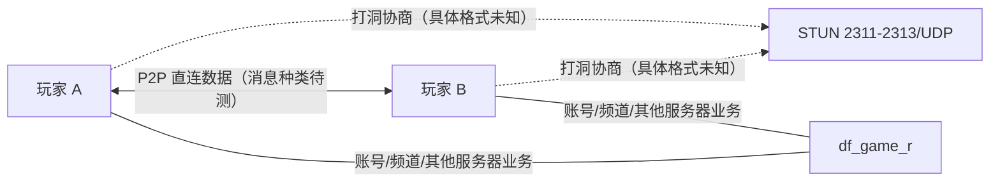
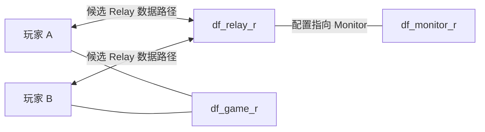

# 网络路径、端口与协议头（静态分析）

## 当前部署示例与历史配置的边界

| 功能 | 现行 `deploy/dnf/docker-compose/basic/docker-compose.yaml` | 其他来源 | 判断 |
|---|---|---|---|
| Channel | 7001/TCP、7001/UDP | `channel/cfg/server.cfg` 由 `__CHANNEL_TCP_PORT__` 替换 | 配置已证实 [E08][E09] |
| Game ch.11 | 30011/TCP、31011/UDP | `game/cfg/server.template` 的频道端口拼接 | 配置已证实 [E04][E09] |
| Game ch.52 | 30052/TCP、31052/UDP | 同上 | 配置已证实 [E09] |
| Relay | 7300/TCP、7300/UDP | `ArchitectureDiagram.md` 写作 7200 | **文档/部署版本差异** [E02][E07][E09] |
| STUN | 2311、2312、2313/UDP | `stun/cfg/udp_server.cfg` 为变量模板 | 配置已证实 [E06][E09] |
| Monitor / Bridge / DBMW | 容器内部端点，没有在该 Compose 示例对外发布 | 历史架构 30303 / 7000 / 20203 等 | 不应推断为公网开放端口 [E01][E03][E21] |

## P2P 成功与 Relay 回退：**候选网络拓扑**

这是基于仓库**文档宣称**的工作方式绘制的候选图，不能推出“移动、攻击、怪物 AI 一定走 P2P”。





仅有“Relay 存在、用于不能直连时中继”的文档证据，**没有**自动回退条件、超时阈值、转发是否解析应用消息的代码证据。`relay_200.cfg` 的 `relay_index=200`、`this_pvp_channel=1` 是配置字段，不足以证明 Relay 只支持 PVP。[E02][E07]

## 游戏应用消息头：字段存在，偏移语义未证实

`game/cfg/server.template:83-90`：

```text
header_classification = 0 1
header_msg_no = 5 1
header_sLength = 1 4
header_checksum = 7 4
header_sequence = 11 2
header_load_interval = 10
header_mangled_length = 13
```

这些是**配置键和值**，可能描述字段位置/长度，但未检查协议解析器之前，不能写成经过验证的封包格式，也不能判定 TCP 与 P2P UDP 是否共用这些字段。[E04]

`frida.js` 明确声明 `PacketBuf_get_byte/short/int/binary` 及 `InterfacePacketBuf_put_header/byte/short/int/binary/finalize`，并在活动广播中调用 `InterfacePacketBuf_put_header(packet_guard, 0, 247/248)`。这证明**Hook 脚本使用编号组包接口**，不等于直接证明底层线上消息 ID/头长度或任何移动技能消息 ID。[E11]

## 通信验证设计（尚未执行）

1. 在授权的隔离环境中，记录两客户端、game、relay、stun 网络五元组；同步记录服务端进程 PID 和每个频道端口。
2. A 单独登录，不组队，建立控制组基线；A/B 组队后保持静止；再执行移动、技能、切房、拾取各 20 次。
3. 使用不同 NAT 条件重复，记录客户端→客户端 UDP 是否出现及发生时间；通过仅在测试网络中阻断直连观察是否改经 Relay。
4. 分别对 Game TCP、Game UDP、STUN、Relay 的流量进行方向、时间、大小统计；**不依靠长度或目的端口赋予业务语义**。
5. 若合法获取解码消息，结合 Hook 入口、明确触发时刻及序列号校验建立消息映射；必要时在隔离环境以 trace 记录 `CUser_Send` 与报文生成时间。
6. 验证“只发移动是否触发 Game 流量”“A 攻击后 B 看到的结果由谁发送”等竞品假设；保留原始 pcap 哈希与复现实验参数。

样例命令（捕获网卡需替换，仅在自己环境运行）：

```bash
sudo tcpdump -i <test-iface> -s 0 -w dungeon-test.pcap \
  'tcp or udp'
```

抓包文件如包含认证信息、角色隐私，应在本地保管并脱敏。相关具体假设见 [移动](movement-sync.md)、[战斗](combat-sync.md)。

## v0.2：Relay 实际符号增强了静态证据

`df_relay_r` 的真实 ELF 符号表存在 `TCPUser::onPacketParse(0x0805D02E)`、`TCPHandlerRelay::dispatch(0x0805B958)`、`UDPHandlerRelay::dispatch(0x0805E4C0)`、`UDPHandlerS2S::dispatch(0x0805E406)`、`RelayService::setAuthenticated`、`PacketHeaderS2S`；还有 `Monitor Auth` 等真实字符串。[E23](evidence.md#e23) [E24](evidence.md#e24)

**已证实**：存在报文解析、鉴权、TCP/UDP 分流相关的实现入口；**未知**：各处理器是否在当前部署中被调用、`S2S` 是什么语义、是否解析角色移动/技能/伤害 payload。要对其进行静态反汇编/运行观察才能回答，不能从名字猜测消息 ID。详见 [binary-static.md](binary-static.md)。

## v0.3：不再只是通过函数名推断 Relay

根据已提取真实机器码，`UDPHandlerRelay::dispatch` 的字段为 0 路径直接调用 `RelayService::relayToTCP`；`relayToTCP` 把首字段改为 3，按缓冲区 +8 标识查找 TCP 用户，然后调用 `TCPUser::send`。TCP Relay 存在账号绑定与另一条转发分支，UDP S2S 有授权/断开分支。[E26](evidence.md#e26) [E27](evidence.md#e27) [E28](evidence.md#e28)

这证明 Relay 具有某种 **UDP→TCP 用户桥接**能力和控制面处理逻辑；没有证明地下城移动/伤害经过这条路径。有关确定的指令地址、输入内存偏移与尚未验证部分，参见 [relay-control-flow.md](relay-control-flow.md)。
