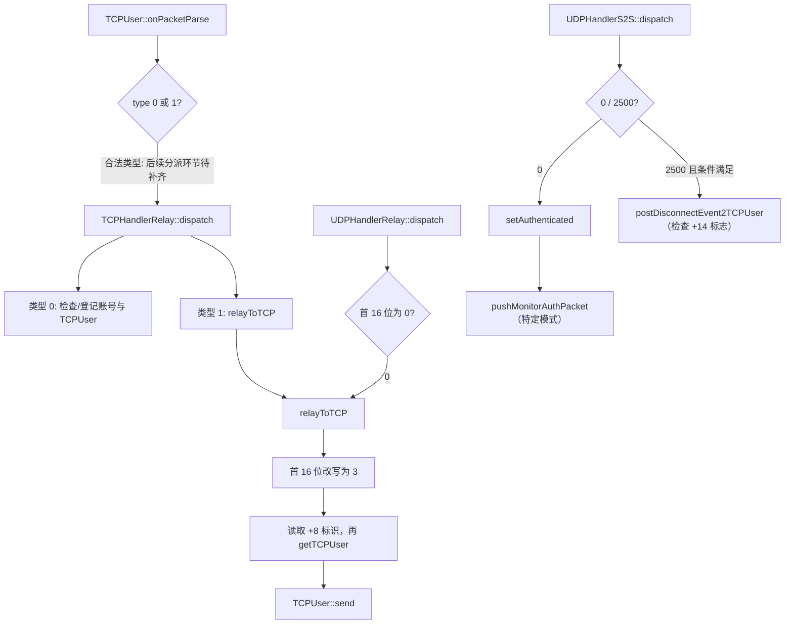

# Relay 控制消息处理调用链：机器码级证据（v0.3）

> 范围：`build/dnf_data/home/template/neople/relay/df_relay_r`，Git Blob SHA `c39c47eeb19127a105a0c3309e9b663de81e239a`，ELF32/x86。方法：对 GitHub 提供的 Base64 二进制解析 `.text` 的 VA/文件偏移，提取指定 ELF 符号标注范围内的**原始机器码字节**，保存成临时裸二进制，并使用本地 GNU `objdump -D -b binary -m i386 -M intel --adjust-vma` 反汇编；结合从同一 ELF `.symtab` 读取的目标地址识别直接调用。**未执行 ELF、未运行客户端、未抓包。**

## 读者先看结论

1. Relay 的 TCP parser 至少检查 **12 字节**可读数据，随后取第 0 字节起的 16 位类型字段、偏移 +2 的 16 位长度字段；不在 `0/1` 集合内的类型会进入断开处理路径。此处是**Relay 的 TCP 接收缓冲区解析**，不等于 Game Server 的消息头格式。
2. TCP Relay `dispatch` 在类型 `0` 分支执行账号 ID 检查、绑定和认证消息请求；在类型 `1` 分支有条件地执行 `relayToTCP`。
3. UDP Relay `dispatch` 在第一个 16 位字段为 `0` 时调用 `relayToTCP`。
4. UDP S2S `dispatch` 对字段 `0` 调用 `setAuthenticated`；字段 `2500(0x09C4)` 且缓冲区 `+14` 字节为 0 时，调用 `postDisconnectEvent2TCPUser`；字段 `1` 当前分支直接返回。
5. `relayToTCP` 将报文第一个 16 位字段改写为 `3`，读取偏移 `+8` 的 32 位值，通过 `Users::getTCPUser` 查用户，找到了再调用 `TCPUser::send`。
6. `setAuthenticated` 在特定脚本/配置状态下调用 `UDPSocket::pushMonitorAuthPacket`，展示 Relay 与 Monitor 授权机制的另一条代码路径。

**边界：** 数字 0/1/3/2500 是这些函数在 x86 内存中比较/写入的数值，**不是经过 PCAP 验证的网络消息 ID**。关于方向、用户名义、网络字节序、实际连接会话及是否承载地牢移动/技能数据，均不能据此越界认定。

## 关键的真实 ELF 调用证据

| 调用者地址 | 指令/判断 | 目标地址（符号名称） | 可以证实 |
|---|---|---|---|
| `0x805E4CF` | `movzx eax, word ptr [eax]` | — | UDP Relay 读取输入对象首个 16 位字段 |
| `0x805E4D5` | `test eax,eax` | — | 只在此字段为 0 时走下述转发路径 |
| `0x805E4F1` | `call 0x8051B76` | `RelayService::relayToTCP` | UDP Relay 的直接调用 |
| `0x805E41C` / `0x805E421` | `cmp eax,1` / `cmp eax,0x9c4` | — | UDP S2S 有 1、2500、0 三类分支 |
| `0x805E44D` | `call 0x8051B2C` | `RelayService::setAuthenticated` | S2S 字段 0 的授权路径 |
| `0x805E488` | `call 0x805196C` | `RelayService::postDisconnectEvent2TCPUser` | 2500 分支、+14 flag 校验后的断开处理 |
| `0x805B967` | `movzx eax, word ptr [eax]` | — | TCP Relay 以首 16 位字段分类 |
| `0x805B985` | `call 0x8052432` | `TCPUser::getACCID` | 账号 ID 前置判断 |
| `0x805B9F7` | `call 0x8052424` | `TCPUser::setACCID` | 类型 0 分支写入账号 ID |
| `0x805BA1E` | `call 0x8051276` | `Users::setTCPUser` | 类型 0 分支建立用户映射 |
| `0x805BA3B` | `call 0x8051B2C` | `RelayService::setAuthenticated` | 类型 0 分支通知授权 |
| `0x805BA86` | `call 0x8051B76` | `RelayService::relayToTCP` | 类型 1 且已关联账号后执行转发 |
| `0x8051B7F` | `mov word ptr [eax],3` | — | `relayToTCP` 会改写首字段为 3 |
| `0x8051B87` | `mov eax,[eax+8]` | — | 从转发报文 +8 取用户标识候选值 |
| `0x8051B97` | `call 0x80510FA` | `Users::getTCPUser` | 根据 +8 字段值查 TCPUser |
| `0x8051BB2` | `call 0x805D752` | `TCPUser::send` | 若用户存在则发送消息 |
| `0x8051B69` | `call 0x804D900` | `UDPSocket::pushMonitorAuthPacket` | `setAuthenticated` 在特定模式下投递 Monitor Auth 包 |
| `0x805D049` | `call 0x805DCEC`，参数 `0xC` | `TDoubleCircularQueueBuffer::isPopStraight` | TCP parser 先检查 12 字节可用性 |
| `0x805D05F` | `call 0x805DD72` | `TDoubleCircularQueueBuffer::peekPop` | 从循环缓冲区取当前数据指针 |
| `0x805D070` | `movzx eax,word ptr [eax+2]` | — | 读取偏移 +2 的 16 位长度值 |
| `0x805D07D` | `movzx eax,word ptr [eax]` | — | 读取起始 16 位类型 |
| `0x805D09F` | `call 0x805D564` | `TCPUser::postDisconnected` | 不在类型 0/1 内时的断开分支 |
| `0x805D0C3` | `call 0x805DCEC` | `TDoubleCircularQueueBuffer::isPopStraight` | 使用读取的长度再次检查可用数据 |

备注：`onPacketParse` 整体大小 1334 字节，目前仅检查了入口的约 220 字节，不能推断后半段的全部内存复制、校验和 dispatch 细节。

## 目前可以复原的具体路径

**图中 `onPacketParse → TCPHandlerRelay::dispatch` 这一条仍是尚未完成完整反汇编的关联假设，其他上述分支是已检查机器码的直接行为。**

## 对多人地下城架构问题的意义

- 有证据证明 Relay 至少支持一条 **UDP handler → TCP 用户发送**的消息桥接路径，且会调整控制字段。
- TCP 用户映射与认证是 Relay 进程内明确存在的处理动作，说明它不是无状态地向固定地址盲转。
- 这仍然**不能**证明普通地下城位置、怪物 AI、技能或伤害通过 Relay，也不能确定 Game Server 与某个玩家 Host 谁拥有权威。

下一步优先处理 `df_game_r` 的完整 ELF 和客户端流量，寻找普通副本真正使用的网络包路径，而不是把 Relay 的认证控制包误认成战斗协议。
