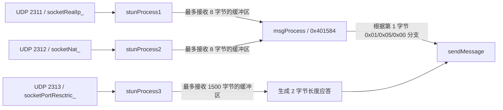

# STUN UDP 端口与请求/响应格式：二进制反汇编（v0.4）

> **对象：** `build/dnf_data/home/template/neople/stun/df_stun_r`，Git Blob `9e8e459f5bc1144617213d3141e2c5a740e2bc2c`，131,126 字节，ELF64/x86-64。  
> **证据类型：** 已证实（静态机器码/符号）。通过 GitHub Base64 获取完整原始文件；解析 ELF `.text` 段和 `.symtab`，提取函数机器码，再以 GNU `objdump -D -b binary -m i386:x86-64 -M intel --adjust-vma` 反汇编。没有运行游戏客户端、STUN 进程或抓包。
>
> **核心限制：** 下列字段的内存布局由写指令确认；“线上实际请求”“客户端对字节序的解释”“公网 NAT 行为”仍必须经授权的客户端抓包验证。端口值适用于**当前这一份特定 STUN ELF**，不能无条件推广到所有版本。

## 一、main 中的真实 Socket 初始化

`main(0x401F64)` 直接调用 `openPort(short unsigned, unsigned)`（符号 `0x401C92`），而不是仅依据 `udp_server.cfg` 文件推断端口。

| main 指令 | 立即数 | 对应 UDP 端口 | Socket 全局地址 | 线程入口 |
|---|---:|---:|---|---|
| `0x402027–0x402036` | `0x907` | **2311** | `socketRealIp_`：`0x603FA4` | `stunProcess1`：`0x4017A4` |
| `0x402067–0x402076` | `0x908` | **2312** | `socketNat_`：`0x603FA8` | `stunProcess2`：`0x401722` |
| `0x4020A7–0x4020B6` | `0x909` | **2313** | `socketPortResctric_`：`0x603FAC` | `stunProcess3`：`0x401674` |

`main:0x40210D/0x402128/0x402143` 把三个函数地址交给 `pthread_create`，三线程创建的顺序与上述对应关系一致。`stunProcess1/2/3` 还会通过 `0x402B98/0x402B78/0x402B50` 的文本记录 `RealIP`、`NAT` 和 `MTU_CHECKER`。

**特别注意：** 仓库中的 `stun/cfg/udp_server.cfg` 包含 `2__SERVER_GROUP__11/12/13` 模板；然而这个 `main` 的三次 `openPort` 调用使用了三个固定立即数。仅依赖修改模板推断该 ELF 可以换端口并不可靠；应结合实际进程启动参数、绑定日志验证是否存在其他重定向或补丁。当前只对**这一份 ELF 的 `main`**做出确定判断。

## 二、线程收包与处理路径



- `stunProcess1:0x4017C7–0x401823` 初始化 `len=8` 并循环调用 `getMessage(0x401AC0)`、`msgProcess(0x401584)`。
- `stunProcess2:0x401745–0x4017A1` 同样使用 `len=8` 的循环，只是 Socket 指向 `socketNat_`。
- `stunProcess3:0x40169D–0x40171C` 令接收缓冲长度为 `0x5DC=1500`；成功后执行 `mov word ptr [rbp-0x20], ax` 写入**收到的实际字节数**的低 16 位，再通过 `sendMessage(0x40189A)` 发送 `len=2` 的响应；目标地址取自 `getMessage` 返回的来源地址对象。这里没发现直接回传 1500 字节负载的调用。

## 三、msgProcess 对请求类型的真实分支

`msgProcess(int socket, char* payload, int len, Address& source)` 的 ELF 符号地址为 `0x401584`，大小 239 字节。

| 输入首字节 | 指令位置 | 实际行为 | 证据等级 |
|---|---|---|---|
| `0x01` | `0x4015A4–0x4015BF` | 生成类型 `0x02` 的 7 字节响应，经传入的 Socket 发送给源地址 | 已证实：内存写入及发送调用 |
| `0x05` | `0x4015AA–0x40160D` | 生成同结构响应，但通过全局 `socketPortResctric_`（2313）发送给源地址 | 已证实：全局 Socket 的读取和发送调用 |
| `0x00` | `0x4015B0`、`0x401667` | 直接返回成功；在本函数中不调用发送 | 已证实：分支 |
| 其他字节 | `0x40165E` | 返回失败 | 已证实：分支 |

`0x01` 分支在 `0x4015BF` 写入应答类型字节 `2`，然后在 `0x4015C7` 从 `source+4` 读 4 字节，在 `0x4015D1` 从 `source+0` 读 2 字节，拼接到应答对象；`0x4015F3` 将响应长度设为 `7`，`0x4015F8` 调用 `sendMessage(0x40189A)`。

`0x05` 分支执行同样的应答字段写入，但是 `0x40163B` 用 `mov edi, [rip+0x20296B]` 获取 `socketPortResctric_`，随后 `0x401649` 用该 Socket 发送。这是**从不同端口回包**的实际静态调用证据，而不是 NAT 教科书推断。

## 四、七字节响应内存布局

```text
偏移 / 长度  0:1       1:4                 5:2
           +--------+-------------------+---------------+
           |  0x02  | 来源 IPv4 地址字段 | 来源 UDP 端口 |
           +--------+-------------------+---------------+
           共 7 字节
```

本报告使用“来源地址字段”而不是强行写明某个字节序：要确认是否为客户端预期的网络序，以及字段内容是否由 `recvfrom` 原样存储、经过 `ntohs/ntohl`，必须进一步对 `getMessage` 和真实 pcap 交叉验证。这些字段也没有凭据表明就是 RFC 5389 标准 STUN 的对应头。

**研究解释（高可信推断）：** 这组小包具备观察客户端 NAT 对外映射以及探测不同源端口返回路径的作用，因为它把服务端观察到的来源地址回送，并且 0x05 通过 2313 而非接收 Socket 应答。但“客户端到底如何分类 NAT”以及“最终 P2P 打洞握手”仍未知。

## 五、后续实验（尚未执行）

1. 在授权、隔离的两客户端环境分别向 2311、2312 发 `0x01`、`0x05` 请求；记录来源端口与响应端口，并与七字节缓冲区结构比对。
2. 固定 UDP 源端口，观察同一客户端在不同 NAT 策略下，2311/2312 回答的外部地址与第三端口应答是否可达。
3. 用 2313 测试不同 UDP 数据报长度，验证返回的两字节值如何编码，排除字节序误判。需要注意路径 MTU 和 IP 分片；实验不对公网第三方服务器进行探测。
4. 结合客户端初始化阶段抓包，确认 STUN 请求之后客户端如何与其他玩家协商端口；仅靠 STUN 服务器代码还无法证明 P2P 成功或 Relay 回退的实际时序。

**无需启动真实服务端进行本报告的静态验证：** 在已经检出的合法本地 Linux 环境，可以针对上述 ELF 直接执行 `objdump -d -M intel --start-address=0x401584 --stop-address=0x401674 build/dnf_data/home/template/neople/stun/df_stun_r` 和 `objdump -d -M intel --start-address=0x401f64 --stop-address=0x40215c ...`。ELF 文件哈希/版本必须一致。
